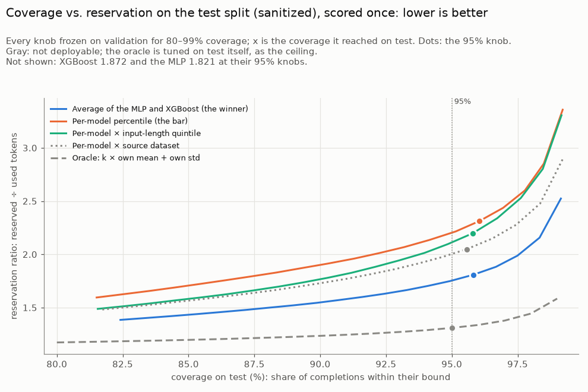
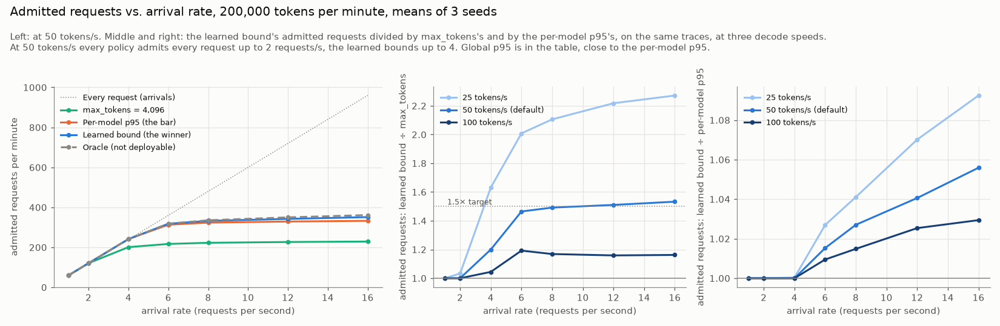
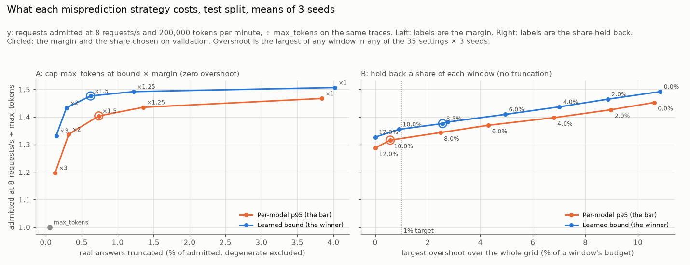

# llm-reserve

**An LLM spend gateway has to reserve budget before it knows what a request will cost, so it reserves the worst case, `max_tokens`, and turns away requests it could have served. llm-reserve predicts a tight 95th-percentile bound on each request's output tokens from its prompt, so the gateway reserves what the request will likely cost instead.**

On the held-out test split of [CASTILLO](https://huggingface.co/datasets/danfperam/castillo) (1,130 prompts, 140k completions from 13 open models), scored once with every choice frozen on validation:

- **20.4% fewer reserved tokens than a fixed per-model 95th percentile at equal (95%) coverage**, 21.8% at the frozen knobs (95.81% coverage). That closes **50% of the gap** to an oracle that knows each prompt's true length distribution. Against `max_tokens` = 4,096 it reserves 82% fewer tokens.
- In a budget-gateway simulator overloaded to 153% of its budget, the learned bound with its default safety cap admits **1.476× as many requests as `max_tokens`** (1.016× the per-model percentile under the same cap), with **zero windows over budget** and 0.62% of real answers cut short.
- Served by FastAPI on ONNX Runtime with atomic Redis reservations in `docker compose`: **`/predict` 12.8 ms p99** and **`/reserve` 0.45 ms p99** at one client. 1,000 parallel reserves never push a window past its budget.

Two caveats belong next to those numbers. **On a kind of prompt the model never saw, the saving falls to about 9%**, because half the gain comes from recognizing CASTILLO's seven benchmark templates. And **the latency targets hold for one caller at a time**, not under concurrent load on a laptop. Both are measured below.

## How it works

A request is (prompt, target model, input size). The predictor turns that into a bound *b* such that the real output is at most *b* for 95% of requests:

1. **Features:** 29 hand-built prompt features (size and shape, code fences, length hints like "in two sentences" or "500 words", cue words, log input size) and a 13-model one-hot, plus a [MiniLM](https://huggingface.co/sentence-transformers/all-MiniLM-L6-v2) embedding of the first 128 tokens, projected to 32 PCA components fitted on train.
2. **Two quantile regressors**, each trained with the pinball loss at the 95th percentile of log1p(output tokens): XGBoost and a small PyTorch MLP (256 → 64, input dropout, hand-written training loop).
3. **The winner is the average of the two in log space**, plus one additive shift tuned on validation to the smallest value that reaches 95% coverage. Bound = ⌈expm1(prediction + shift)⌉.
4. **The gateway never trusts the bound blindly.** It sends the LLM call with `max_tokens` = min(⌈1.5 × bound⌉, the client's `max_tokens`) and reserves exactly that, so no request can cost more than it reserved. The 1.5 margin was chosen on validation as the smallest that cuts at most 1% of real answers.
5. **The service** answers `/predict` with ONNX Runtime alone (no torch or xgboost in the 761 MB image), and `/reserve` and `/settle` with Redis Lua scripts, so admission and refunds are atomic across workers.

The evaluation is the part that took the most care: prompts that leaked across CASTILLO's official splits are moved to their earliest split (a test asserts zero overlap); no feature reads the dataset's own length statistics (a test asserts the forbidden columns never appear); every method is compared **at matched coverage**, never at its own; and the test split was read once, on Day 7, after every choice was frozen on validation. Everything that didn't work is in [docs/findings.md](docs/findings.md), which is the full results log (48 numbered findings).

## Results

### Prediction (test split, scored once)

Reservation ratio = tokens reserved ÷ tokens used, over all completions; lower is better at the same coverage.

| Method | Deployable | Coverage | Reservation ratio | vs. the bar | Ratio at exactly 95% | vs. the bar at 95% | Oracle gap closed |
|---|---|---|---|---|---|---|---|
| `max_tokens` = 4,096 | yes | 99.93% | 9.916 | +328.7% | — | — | — |
| Global 95th percentile | yes | 95.51% | 2.368 | +2.4% | 2.281 | +3.5% | −5.5% |
| **Per-model percentile (the bar)** | yes | 96.05% | **2.313** | — | **2.203** | — | 0% |
| Per-model × input-length quintile | yes | 95.79% | 2.197 | −5.0% | 2.111 | −4.1% | 11.5% |
| Linear quantile regression | yes | 95.55% | 2.258 | −2.4% | 2.205 | +0.1% | 5.5% |
| XGBoost (hand-built + MiniLM PCA-32) | yes | 95.74% | 1.872 | −19.1% | 1.815 | −17.6% | 43.9% |
| MLP (hand-built + MiniLM PCA-32) | yes | 95.81% | 1.821 | −21.3% | 1.766 | −19.8% | 49.0% |
| **Average of the MLP and XGBoost (the winner)** | yes | **95.81%** | **1.808** | **−21.8%** | **1.753** | **−20.4%** | **50.3%** |
| Per-model × source dataset (reference) | no | 95.56% | 2.048 | −11.4% | 2.002 | −9.1% | 26.3% |
| Oracle: k × own mean + own std (ceiling) | no | 95.00% | 1.309 | −43.4% | 1.309 | −40.6% | 100% |

A bootstrap over whole prompts puts the frozen saving between −23.3% and −20.3% (95% interval). The 20% target is met by 0.4 points at equal coverage: XGBoost or the MLP alone would not have met it; the average chosen on validation does. Every target model lands between 95.0% and 96.5% coverage, and the winner saves on every one: 13–23% on eleven of them and 46% and 34% on the two Gemma models, whose output lengths a per-model percentile fits worst.



**Leave one dataset out.** With each of CASTILLO's seven source benchmarks held out of training in turn, the winner still beats its bar on 6 of 7, but pooled the saving is **−9.3% at equal coverage (21% of the oracle gap)** and frozen coverage falls to **93.9%**, as low as 77.4% on ShareGPT, the real-user chat set and the one most like gateway traffic. A control that removes a random seventh of the training prompts keeps −20.1%, so this is template recognition, not data size. Expect about −10% on new traffic until the quantile is re-tuned on it ([finding 24](docs/findings.md#24-on-a-benchmark-the-model-never-saw-half-the-gain-is-gone)).

### Budget simulator

A discrete-event gateway with a token budget per 60 s window, Poisson arrivals, 50 tokens/s decoding, and each request billed to the window that admitted it, replayed on the test split's original config (degenerate runaways included), 3 seeds per setting.



| At 8 requests/s, 200k tokens/min (demand 153% of budget) | Admitted | ÷ `max_tokens` | Windows over budget | Largest overshoot | Real answers cut short |
|---|---|---|---|---|---|
| `max_tokens` = 4,096 | 13,377 | 1.000× | 0 | 0% | 0.06% |
| Per-model p95, unprotected | 19,428 | 1.452× | 36.7 of 60 | 8.00% | 0.06% |
| Learned bound, unprotected | 19,953 | 1.492× | 39.0 of 60 | 7.43% | 0.06% |
| Per-model p95, cap at 1.5× | 18,774 | 1.404× | 0 | 0 | 0.74% |
| **Learned bound, cap at 1.5× (the default)** | **19,745** | **1.476×** | **0** | **0** | **0.62%** |

What the simulator says, plainly:

- **Below saturation nothing changes.** At 4 requests/s every policy except `max_tokens` admits everything, so the learned bound's advantage is 1.20× `max_tokens` and 1.00× the bar: there is no more room. 85% of `max_tokens`'s rejections are wrongful (the request would have fit).
- **The ≥1.5× target is met only past saturation:** from 12 requests/s at 200k (1.55× with the cap), from 6 at 100k, from 4 at 25 tokens/s, and **never at 100 tokens/s** (at most 1.22×), where fast decoding returns oversized reservations before they cost much. Most of the gain over `max_tokens` is reserving a 95th percentile at all; the learned bound adds 1–10% over the per-model percentile, up to 20% under the cap at small budgets.
- **Every bound below `max_tokens` overshoots once the budget binds** (up to 10.9% of a window), which is why the cap is the default: it has zero overshoot by construction. An overdraft buffer sized on validation was tried as the alternative and missed the 1% target on test (2.56%).
- **A tight bound favours cheap requests.** Under overload the learned bound admits short Alpaca questions at 73% and long Apps coding answers at 63%. That maximizes requests per budget; it is a choice the operator should know about.



### Service

Measured in `docker compose` on an M5 laptop (10 cores; Docker's VM has 10 CPUs and 7.7 GiB) through Docker's port forward, with a keep-alive asyncio client; default configuration (int8 encoder on 2 ONNX threads, one uvicorn worker).

| Call | Clients | p50 | p99 | Target | Requests/s |
|---|---|---|---|---|---|
| `/predict` | 1 | 7.0 ms | **12.8 ms** | 15 ms ✅ | 169 |
| `/predict` | 4 | 13.1 ms | 21.4 ms | 15 ms ❌ | 351 |
| `/predict` | 8 | 18.9 ms | 33.3 ms | 15 ms ❌ | 457 |
| `/reserve` | 1 | 0.32 ms | **0.45 ms** | 5 ms ✅ | 1,510 |
| `/reserve` | 16 | 2.1 ms | 7.6 ms | 5 ms ❌ | 3,618 |
| `/reserve` | 64 | 8.5 ms | 22.4 ms | 5 ms ❌ | 3,555 |

- **The fp32 encoder ran at 33 ms p99 in Docker**, against 12.5 ms natively on macOS, because Docker's Linux VM doesn't expose the M5's SME units. A per-channel int8 encoder fixed it after passing a coverage rule written before the run (test coverage 95.81% at 1.807, unchanged).
- **The 1,000-request burst found a real bug:** redis-py's default pool raises instead of waiting, so 511 of 1,000 requests got a 500. With a blocking pool, 147 were admitted (199,977 of 200,000 tokens), every 429 was rightful, and the counter matched to the token with one or two workers.
- **Under load both calls queue on this laptop.** `/predict` holds two cores per request; one `/reserve` worker saturates near 3,600 reserve-and-settle pairs a second. Two workers stay exact and reach 5,300. Meeting the targets under load needs more cores, workers or replicas, which weren't tried.

### Targets

| PRD target | Result | Met |
|---|---|---|
| 95% ± 1% coverage on test | 95.81% (95.67% with degenerate runs) | yes |
| ≥ 20% fewer reserved tokens than per-model p95 at matched coverage | −20.4% (−21.8% at frozen knobs) | yes, by 0.4 pt |
| ≥ 1.5× admitted vs. `max_tokens` in simulation | 1.476× at 8 req/s; 1.55× at 12 req/s; never at 100 tok/s | only past saturation |
| Overshoot ≤ 1% of a window | 0 with the 1.5× cap | yes |
| `/predict` p99 ≤ 15 ms on CPU | 12.8 ms at 1 client; 21.4 ms at 4 | at one client |
| `/reserve` p99 ≤ 5 ms | 0.45 ms at 1 client; 7.6 ms at 16 | at one client |

## Run it

Requires Python 3.12 and Docker (Docker Desktop or OrbStack). From a clean clone:

```bash
make setup      # .venv from the pinned requirements.txt
make data       # download CASTILLO at a pinned revision (~600 MB, cached in data/raw), fix the split leakage
make train      # features + MiniLM embeddings, XGBoost and linear models, the MLP
make eval       # the test split, scored once, plus leave-one-dataset-out
make sim        # the budget simulator, max_tokens end to end
make sweep      # every policy over arrival rate, budget and decode speed
make mispredict # cap vs. overdraft buffer, knobs chosen on validation
make onnx       # export the winner and the int8 encoder to data/models/onnx/, with parity and coverage checks
make int8-served # repeat the int8 coverage check on the embeddings the service image computes (needs Docker)
make serve      # API + Redis on http://localhost:8000
make demo       # predict -> reserve -> settle with curl
make bench      # latency benchmark and the 1,000-request burst against the running service
make down
make test
```

**Tested from a fresh clone on 5 Nov 2026** (M5 laptop, `OMP_NUM_THREADS=4`, niced): every stage above through `make down` ran without a manual step, 142 of 142 tests passed, and every regenerated number matched the committed one; only timings differed. Times: `setup` 6 min, `data` 60 min (almost all of it the download), `train` about 11 min (features under 3, models 6.5, the MLP 2.3), `eval` 4.9 min, `sim` 2 s, `sweep` 23 s, `mispredict` 2.4 min, `onnx` 1.5 min, `test` 8 s, `serve` 2.3 min (image build). Details in [findings](docs/findings.md#day-14-ship-5-nov-2026).

Training uses every core through XGBoost; `OMP_NUM_THREADS=4 make train` keeps the machine usable. Each `make` stage rewrites its figures and JSON under `docs/figures/`, so `git diff` after a run shows exactly what changed.

A gateway calls the service three times per LLM request: `/predict` for the bound, `/reserve` to hold budget, and `/settle` with the provider's reported usage.

```bash
curl -s localhost:8000/predict -H 'content-type: application/json' \
  -d '{"prompt": "Explain in two sentences why the sky is blue.", "model": "meta-llama/Llama-3.1-8B-Instruct", "input_tokens": 20}'
curl -s localhost:8000/reserve -H 'content-type: application/json' \
  -d '{"input_tokens": 20, "max_tokens": 4096, "bound": 210}'   # 429 with Retry-After when the window is full
curl -s localhost:8000/settle -H 'content-type: application/json' \
  -d '{"reservation_id": "<from /reserve>", "input_tokens": 20, "output_tokens": 126}'
```

`/reserve` returns the `max_tokens` to send with the LLM call (the 1.5× cap) and holds exactly that. Settle refunds or charges the difference and deletes the reservation in one script, so a retried settle gets a 404 instead of refunding twice.

Settings come from the environment: `BUDGET_TOKENS` (default 200,000 per `WINDOW_SECONDS` = 60), `CAP_MARGIN` (1.5), `ENCODER` (`int8` or `fp32`), `PREDICT_THREADS` (2), `WEB_CONCURRENCY` (uvicorn workers, 1), `REDIS_MAX_CONNECTIONS` (64).

## Layout

| Path | What |
|---|---|
| `src/llm_reserve/data.py` | Download, leakage fix, `sanitized` as a view of `original` |
| `explore.py`, `baselines.py`, `evaluate.py` | Exploration, the baselines and the oracle, matched-coverage metrics |
| `features.py`, `models.py`, `mlp.py` | Features and embeddings, linear and XGBoost quantile models, the MLP |
| `predict.py`, `holdout.py`, `lodo.py` | The one-time test scoring, error analysis, leave-one-dataset-out |
| `simulate.py`, `sweep.py`, `mispredict.py` | The gateway simulator, the policy sweep, the misprediction strategies |
| `export.py`, `quantize.py`, `serving.py` | ONNX export and parity, the int8 encoder, the runtime `Predictor` |
| `service.py`, `bench.py` | FastAPI + Redis Lua service, the benchmark client |
| `docs/PRD.md`, `docs/findings.md` | The plan and the day-by-day results log |
| `docs/blog.md` | A write-up of the project |

## Limits

- **CASTILLO covers open models only** (13 models from 1B to 70B parameters, fixed sampling per model). Whether the predictor transfers to a closed API model is the first item for version 2.
- **Prompt-only bounds can't see runaways:** three quarters of the worst misses are repetition loops and lone long runs of a prompt that is usually short ([finding 23](docs/findings.md#23-three-quarters-of-the-worst-misses-are-runaways-and-lone-long-runs-which-no-prompt-only-bound-can-see)). The cap handles their cost; streaming top-ups (version 2) would handle them without truncation.
- **The quantile is tuned once on CASTILLO's validation split.** On new traffic it should be re-tuned, or adapted online, before its 95% can be trusted.

Data: [CASTILLO](https://huggingface.co/datasets/danfperam/castillo) (CC BY 4.0), Perez-Ramirez, Kostic and Boman, [arXiv 2505.16881](https://arxiv.org/abs/2505.16881).
