# Findings

Living results log for llm-reserve. Each section says which split it uses. The test split was not explored before Day 7, when it was scored once with every choice frozen.

## Day 2: Exploring the data (30 Oct 2026)

**Scope.** Train split only: 7,999 prompts, 97,827 (prompt, model) samples, 976,769 sanitized completions (978,270 original). Validate is kept for tuning, so it isn't explored here. Rebuild everything below with `make explore`; the numbers come from [`figures/explore_stats.json`](figures/explore_stats.json).

Overall output length (sanitized): p50 369, p90 776, **p95 1,005**, p99 1,649, p99.9 2,652 tokens.

### 1. The prompt decides length, not the model

How much of the variance in log(1 + output tokens) each grouping explains, if you knew its exact mean length (in-sample, so an upper bound):

| Grouping | Known at serving time? | Log-variance explained |
|---|---|---|
| Model | yes | **0.6%** |
| Source dataset | no | 13.0% |
| Model × source dataset | no | 23.7% |
| Prompt | via its text | **70.6%** |
| Prompt × model | via its text and the model | **93.4%** |

The fixed per-model p95 (the Day-3 bar) uses only the first row. Knowing the source dataset, which we can't at serving time, still leaves most of the signal unused. The signal is in what each prompt asks for, which matches the data check: per-model × dataset only saves 11%, and the oracle saves about 40%.

**So:** the prompt-text features (Day 4) are the whole project. A model that mostly learns "which LLM" or "which kind of task" will lose to the per-model p95 by very little or tie it.

### 2. Models disagree about which prompts are long

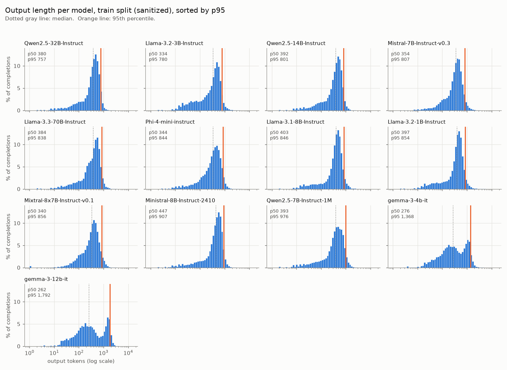

Per-model p95 runs from 757 (Qwen2.5-32B) to 1,792 (gemma-3-12b). Eleven of the 13 models look alike: one main peak just below the p95, and a p95 between 757 and 977. The two gemma models are different: the **lowest medians (262 and 276) but the highest p95s (1,792 and 1,368)**, with a second peak around 1,500 tokens.

That second peak comes from the prompt type. gemma-3-12b is terse on code and verbose on chat; Qwen2.5-32B does the opposite:

| Source dataset | gemma-3-12b median | gemma-3-12b share > 1,000 | Qwen2.5-32B median | Qwen2.5-32B share > 1,000 |
|---|---|---|---|---|
| DS1000 (code) | 46 | 0% | 317 | 0% |
| Apps (code) | 196 | 1% | 576 | 1% |
| Alpaca (instructions) | 478 | 36% | 201 | 0% |
| ShareGPT (chat) | 1,369 | 67% | 455 | 4% |

Across all 13 models, the median correlation of per-prompt mean log length between two models is 0.81, so most prompts rank similarly. But going from "prompt" to "prompt × model" in the table above adds about 23 points of explained variance.

**So:** the model must interact with the prompt features, not just shift or scale them. XGBoost gets this from splits on the model one-hot. For the MLP (Day 6), feed the model embedding into the hidden layers, not only as an output offset. Gemma will dominate the per-model p95 cost, so it is also where a prompt-aware model can save the most.

### 3. Prompt length is a weak signal, and not a monotone one

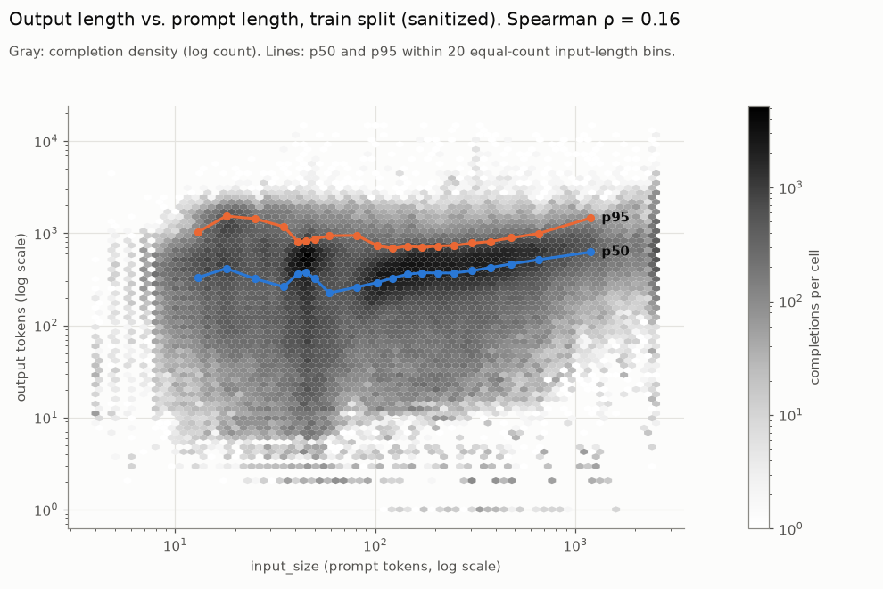

Spearman ρ between `input_size` and output length is only **0.16**. The p95 per input-length bin is U-shaped:

| Prompt tokens (bin median) | 13–35 | 41–81 | 102–305 | 377–654 | 1,193 |
|---|---|---|---|---|---|
| Output p95 | 1,026–1,543 | 813–947 | 685–781 | 816–993 | 1,466 |

Very short prompts are mostly open-ended chat and instructions (ShareGPT median input 56 tokens, output p95 1,541). Mid-length prompts are mostly self-contained code tasks (Mbpp, DS1000: output p95 593–623). The longest prompts get longer answers again (Apps, the code dataset with the longest prompts at a median of 449 input tokens, has an output median of 486).

**So:** this is why the per-model × input-length quintile baseline only saves 4.6%. Use log `input_size` and let trees split it; a linear term in raw length will fit badly. Short prompts need the text features most, because their length tells you least.

### 4. The same prompt to the same model varies a lot, and by how much varies too

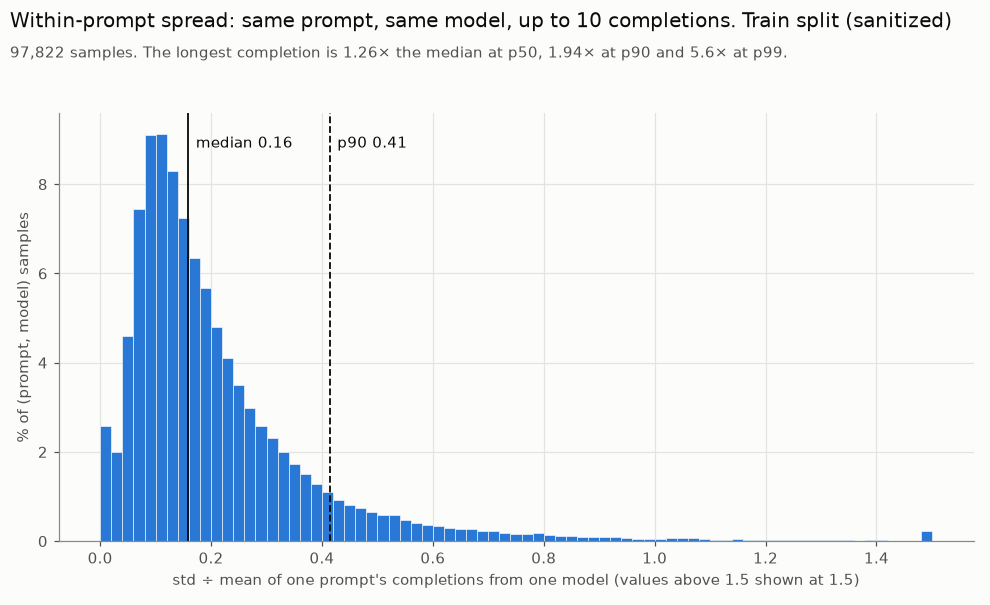

For each (prompt, model) pair, std ÷ mean across its completions: median **0.16**, p90 0.41, p99 0.98 (97,822 samples with at least 2 completions). The longest completion is 1.26× the median at p50, 1.94× at p90 and 5.6× at p99. About 7% of the log variance sits inside a (prompt, model) pair, and no prompt-only predictor can remove it. It is why even the oracle reserves 1.31× actual usage.

The spread itself varies a lot between prompts: a tenth of samples have a CV under 0.06 and a tenth have one above 0.41.

**So:** the 95% bound can't be "predicted mean × a constant". It needs the spread too, which is why the models are quantile models (pinball loss) and not mean regressors with a fixed multiplier. On Day 7, check whether under-predictions are concentrated in high-spread prompts.

### 5. Degenerate runs are a small-model problem; gemma's long outputs are real

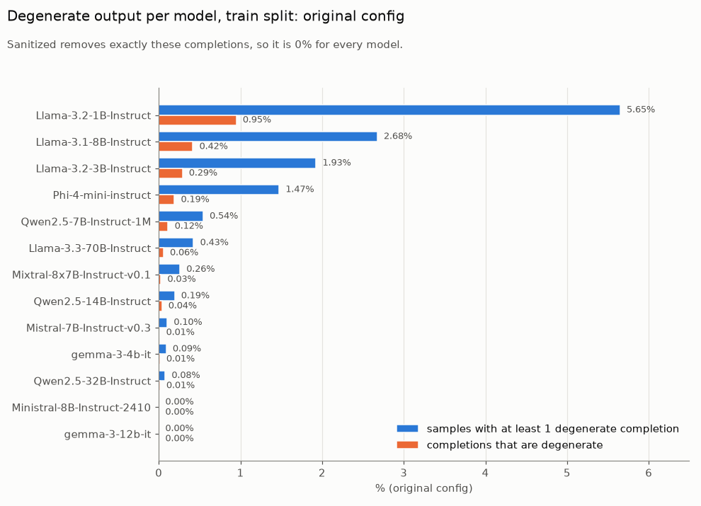

In the original config, **5.65% of Llama-3.2-1B samples have at least one degenerate completion** (0.95% of its completions), then Llama-3.1-8B (2.68%), Llama-3.2-3B (1.93%) and Phi-4-mini (1.47%). The other nine models are at 0.54% or less. gemma-3-12b and Ministral-8B have none.

So gemma's heavy tail (finding 2) is not a decoding failure that sanitized hides: it is real, verbose output, and it is in the training data the model learns from.

Original vs. sanitized on train: 0.181% vs. 0.028% of completions are over 4,096 tokens, and 1,482 original completions hit the 15,000 cap. Only 2 samples are degenerate in all 10 completions (both Qwen, all at 15,001 tokens).

**So:** the simulator draws actual lengths from `original` (as planned), and its clipped-request and overshoot counts should be broken down per model, since four small models produce most of the runaway generations. A model trained on sanitized data will not predict these; that's expected and it's what the misprediction strategies on Day 10 are for.

## Day 3: Baselines locked (30 Oct 2026)

**Scope.** Validation split, sanitized config: 2,266 prompts, 277,351 completions, mean length 421. Every percentile and the input-length quintile edges are fitted on train; only the knob θ (which percentile, or the oracle's k) is tuned on validation, to the smallest value that reaches 95% coverage. Bounds are rounded up to whole tokens. Rebuild with `make baselines`; the numbers come from [`figures/baselines_validate.json`](figures/baselines_validate.json).

| Method | Deployable | Knob θ | Coverage (sanitized) | Coverage (original) | Reservation ratio | vs. the bar | Oracle gap closed |
|---|---|---|---|---|---|---|---|
| `max_tokens` = 4,096 | yes | — | 99.96% | 99.80% | 9.723 | +333.0% | — |
| Global percentile | yes | 0.9463 | 95.01% | 94.86% | 2.322 | +3.4% | −8.1% |
| **Per-model percentile (the bar)** | yes | 0.9539 | 95.00% | 94.85% | **2.246** | — | 0% |
| Per-model × input-length quintile | yes | 0.9529 | 95.00% | 94.85% | 2.142 | −4.6% | 11.1% |
| Per-model × source dataset | no | 0.9535 | 95.00% | 94.85% | 1.993 | −11.3% | 27.0% |
| Oracle: k × own mean + own std | no | 1.1093 | 95.00% | 94.94% | **1.309** | −41.7% | 100% |

"Coverage (original)" applies the same frozen θ to the original config, degenerate completions included (the oracle recomputes its mean and std there).

**The bar is 2.246.** A model hits the 20% target at a reservation ratio of **1.797** or less at 95% coverage on test, which is closing 48% of the gap to the oracle. These numbers reproduce the PRD data check (2.25 / 2.14 / 2.00 / 1.31) on the overlap-fixed validation split, so the baselines are locked.

### 6. The bar is only the strongest simple baseline near 95%

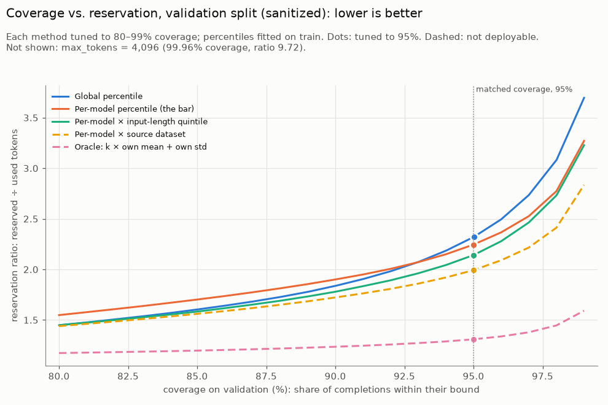

Below about 93% coverage, **one global percentile reserves less than the per-model percentile** (at 90%: 1.84 vs. 1.90). A per-model percentile gives every model the same coverage, which forces it to cover gemma's long second peak (finding 2) at the same rate as everyone else. A global percentile lets gemma's coverage drop and spends the savings on the other eleven models. Above 93%, the per-model percentile wins because the global one has to cover gemma's tail with everyone's bound.

**So:** equal coverage per model is not the cheapest way to reach 95% overall. A learned model is free to cover some models less, and that has to be visible: on Day 7, report coverage per model (and per source dataset) next to the overall number, so a win is not bought by quietly under-covering gemma.

### 7. Input length adds little, the dataset adds more, and both are small next to the prompt

Per-model × input-length quintile saves 4.6%. Knowing the source dataset, which the gateway can't, saves 11.3%. The oracle saves 41.7%. The gap between the bar and the oracle widens as coverage rises: 0.38 at 80% coverage (1.55 vs. 1.17), 0.94 at 95% and 1.68 at 99% (3.27 vs. 1.59). The tail is where a prompt-aware bound pays most. The sanitized-tuned θ loses 0.15 points of coverage on the original config for every percentile baseline, which is the degenerate tail that the simulator (Day 8) will have to absorb.

## Day 4: Features (31 Oct 2026)

**Scope.** Features for all three splits; the checks below fit on train and score on validation. Rebuild with `make features` (1 min 50 s from scratch, 18 s when the embeddings are cached); the numbers come from [`figures/features_validate.json`](figures/features_validate.json).

Every feature is computed from what a gateway has before it sends a request: the prompt text, `input_size` and the target model.

- **29 hand-built features:** size and shape (log characters, words, lines and bullets; code fences; shares of code characters, digits, upper case and non-ASCII; question marks; URLs), log `input_size`, 4 length hints and 13 cue words.
- **A 13-model one-hot,** with its vocabulary fitted on train.
- **MiniLM embeddings** (`all-MiniLM-L6-v2`, pinned revision), 384 dimensions, one per unique prompt (11,395), on CPU as at serving time. They are built at 128 tokens (the serving default) and at 256.

The matrix has one row per completion of the original config (sanitized is the `is_degenerate` filter, as on Day 1) and stores `prompt_row` instead of the embedding, so 1.4M rows × 384 floats are never materialized. Leakage is checked three ways: `check_no_leaks` runs whenever the matrix is built or loaded; a unit test shuffles the label, flips the degenerate flag and adds every never-column, and the features don't change; and on the real matrix every feature is constant within each (prompt, model) sample, so nothing that varies by completion, as the label does, can reach a model.

### 8. Length hints are precise but rare

When a prompt asks for a word count above 30, the answer follows it. Train prompts asking for 31–60, 61–120, 121–250, 251–600 and more than 600 words get median outputs of 61, 125, 224, 698 and 1,028 tokens. Asking for a number of sentences is just as telling: those prompts have a median output of 66 tokens, against 398 without one.

But the hints rarely fire. On train, a word count appears in 1.3% of prompts, a sentence count in 0.5%, a paragraph count in 0.04% and an item count ("list 10", "five ideas") in 4.2%. Item counts barely track length (rank correlation 0.09), since "N points" is often a geometry input in Apps, not a request. Counts of 30 words or fewer are mostly not hints at all: they are problem text in code tasks ("Given two words and a letter", "contains at least one word").

**So:** hints help the few prompts that have them and can't carry the project. Most of the signal has to come from the embedding.

### 9. The embedding carries most of the signal, and 128 tokens costs nothing measurable

As a probe, not a model: a ridge regression of each (prompt, model) sample's mean log length, fitted on train, then scored as the share of completion-level log-length variance it explains on validation. λ is picked on validation from 1 to 10⁵.

| Features | Count | Validation R² of log length |
|---|---|---|
| Model one-hot | 13 | 0.5% |
| + hand-built | 42 | 14.9% |
| Model + MiniLM-128 | 397 | 33.5% |
| **+ hand-built + MiniLM-128** | 426 | **37.5%** |
| + hand-built + MiniLM-256 | 426 | 37.0% |
| Ceiling: each sample's own mean (in-sample) | — | 93.2% |

The embedding alone explains more than twice as much as the hand-built features, and together they add 4 points to the embedding alone. 256 tokens is no better than 128 in this probe (37.0% vs. 37.5%), even though 46% of prompts are cut at 128 MiniLM tokens and 28% at 256. Code tasks are 76% of the prompts cut at 128 (Apps alone 39%; 98% of Apps prompts are cut), ShareGPT and Dolly's pasted context most of the rest, and the log character and line counts still see the full length.

A linear probe can't model the prompt × model interaction (finding 2), which is most of the gap to the ceiling, so Day 5's XGBoost should land well above 37.5%. The 128 vs. 256 check reruns there, on the reservation ratio, before 128 is frozen.

### 10. The text names its source dataset, so the 11% reference row is not out of reach

The dataset is never a feature. But a nearest-centroid rule on the embedding alone names a validation prompt's source dataset 77% of the time at 128 tokens (80% at 256), across 7 datasets, because CASTILLO's datasets have fixed templates ("QUESTION:", "You are an expert Python programmer", "Problem:", "Context:"). Per-model × source dataset, a reference row that is "not deployable" on Day 3 (ratio 1.993, −11.3%), is therefore largely reachable from the text on this data.

That is fair at serving time, since the template is in the prompt. But real gateway traffic has no CASTILLO templates, so part of any gain may not transfer. **So:** the Day-7 leave-one-dataset-out check is no longer a stretch goal. It is the test of whether the model learned what prompts ask for or which benchmark they came from.

## Day 5: Linear and XGBoost models (31 Oct 2026)

**Scope.** Trained on train (sanitized, 976,769 completions), tuned on validation (sanitized, 277,351 completions); test is not loaded. Each model predicts the 95th percentile of log1p(output tokens) with the pinball loss. Its knob θ is an additive shift on that log prediction, bound = ⌈expm1(prediction + θ)⌉, tuned on validation to the smallest shift that reaches 95% coverage, the same protocol as the baselines. XGBoost early-stops on validation pinball loss. Rebuild with `make models` (7 min: 2 min for the linear LP, 3 min for the raw-embedding XGBoost, about 30 s for each other model); the numbers come from [`figures/models_validate.json`](figures/models_validate.json). The fitted models and their frozen shifts are in `data/models/` for Day 7.

| Method | Shift θ | Coverage (sanitized) | Coverage (original) | Reservation ratio | vs. the bar | Oracle gap closed |
|---|---|---|---|---|---|---|
| Per-model percentile (the bar) | — | 95.00% | 94.85% | 2.246 | — | 0% |
| Per-model × input-length quintile | — | 95.00% | 94.85% | 2.142 | −4.6% | 11.1% |
| Linear quantile regression (hand-built) | +0.017 | 95.00% | 94.85% | 2.195 | −2.3% | 5.4% |
| XGBoost (hand-built) | +0.043 | 95.00% | 94.85% | 1.903 | −15.3% | 36.6% |
| XGBoost (hand-built + raw MiniLM-128, 384 dims) | +0.094 | 95.00% | 94.85% | 1.853 | −17.5% | 41.9% |
| **XGBoost (hand-built + MiniLM-128, PCA-32)** | +0.082 | 95.00% | 94.85% | **1.815** | **−19.2%** | **45.9%** |
| XGBoost (hand-built + MiniLM-256, PCA-32) | +0.084 | 95.00% | 94.85% | 1.831 | −18.4% | 44.2% |
| Oracle: k × own mean + own std | — | 95.00% | 94.94% | 1.309 | −41.7% | 100% |

"Hand-built" always includes log `input_size` and the 13-model one-hot. The linear model is fitted on a random 50,000 completions (the exact LP takes 2 minutes at that size, and 5 seconds at 10,000).

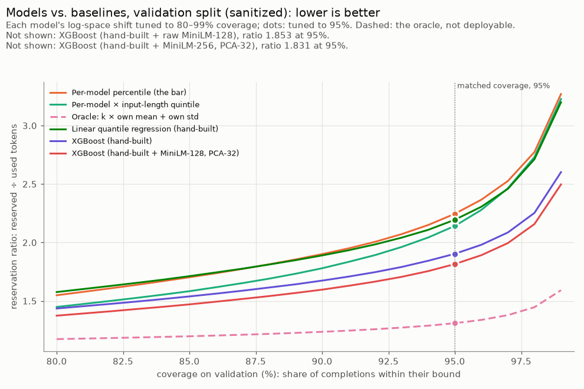

### 11. XGBoost beats the bar by 19% on validation, just short of the 20% target

The best model, XGBoost on hand-built features plus a 32-component PCA of the MiniLM-128 embedding, reserves 1.815× what is used at 95% coverage, against 2.246 for the per-model percentile. That closes 46% of the gap to the oracle, short of the 48% (1.797) the target asks for **on test**. The lead holds along the whole curve: 1.37 vs. 1.55 at 80% coverage, 1.60 vs. 1.90 at 90%, and 2.50 vs. 3.27 at 99%. The frozen shift loses the same 0.15 points of coverage on the original config as every baseline.

Two things make this validation number optimistic. Both early stopping and the shift are tuned on validation, and the feature design below was chosen on validation from 12 configurations. Day 7's test score is the number that counts. **So:** XGBoost beats the fixed 95th percentile, and the 20% target is not reached yet. Day 6's MLP, with the model interacting with the prompt in its hidden layers, has to find the last 1–2%.

### 12. Trees overfit the raw embedding; a 32-component projection fixes it

Each train prompt appears in about 120 rows (10 completions × 12 models) with the same 384 embedding values, so a tree can carve out a single prompt and fit its completions. On the raw embedding, validation pinball loss gets **worse** than with hand-built features alone (0.0599 vs. 0.0595), and early stopping triggers sooner (473 vs. 732 rounds). The reservation ratio still improves a little, because the bound's ranking gets better while its calibration gets worse. Every configuration tried, on validation:

| Embedding features | `min_child_weight` | Validation pinball loss | Ratio at 95% |
|---|---|---|---|
| none | 20 | 0.05951 | 1.907 |
| none | 300 | 0.05898 | 1.903 |
| raw MiniLM-128 (384) | 20 | 0.05988 | 1.874 |
| raw MiniLM-128 (384) | 300 | 0.05948 | 1.853 |
| raw MiniLM-256 (384) | 20 | 0.05961 | 1.861 |
| PCA-16 of MiniLM-128 | 300 | 0.05677 | 1.827 |
| PCA-32 of MiniLM-128 | 20 | 0.05723 | 1.828 |
| **PCA-32 of MiniLM-128** | **300** | **0.05688** | **1.815** |
| PCA-64 of MiniLM-128 | 300 | 0.05727 | 1.815 |
| PCA-32 of MiniLM-256 | 300 | 0.05759 | 1.831 |
| Out-of-fold ridge score of the embedding (1 feature) | 20 | 0.05724 | 1.831 |
| Ridge score + PCA-32 | 20 | 0.05698 | 1.819 |

The PCA is fitted on train prompts only. Projecting to 16–64 components gives the trees a few dense directions instead of 384 noisy ones. A `min_child_weight` of 300 (more than one prompt's ~120 rows) stops leaves from isolating a single prompt. The two fixes add up. PCA-64 ties PCA-32 on ratio but has a worse pinball loss and twice the inputs, so PCA-32 is frozen. A stacked ridge score of the embedding does as well as PCA, but needs out-of-fold fitting and gains nothing. Training also gets 6× faster (33 s vs. 3 min).

The shift θ tells the same story. The linear model needs +0.017 to reach 95%, so its training quantile was almost calibrated on new prompts. XGBoost on hand-built features needs +0.043, and the embedding models need +0.08 to +0.09: their raw 95th-percentile predictions run 8–9% low on prompts they have not seen.

### 13. 128 tokens wins again, so it is frozen

With the frozen design, MiniLM-128 beats MiniLM-256 (1.815 vs. 1.831, pinball 0.0569 vs. 0.0576). On the raw embedding, 256 was slightly ahead (1.861 vs. 1.874), but both of those models overfit. This matches the Day-4 probe (37.5% vs. 37.0%) and the latency check, so **128 tokens is frozen** for training and serving.

### 14. The linear model only beats the bar because of the prompt's length

Linear quantile regression saves 2.3% and loses to the per-model × input-quintile baseline (2.195 vs. 2.142). A linear model in log space can shift each model's bound by a constant, and scale it with input length and cue words, but it can't let a feature mean different things for different models (finding 2) or bend with input length (finding 3). XGBoost on the same features saves 15.3%, so the hand-built features carry the signal and linear quantile regression can't use it.

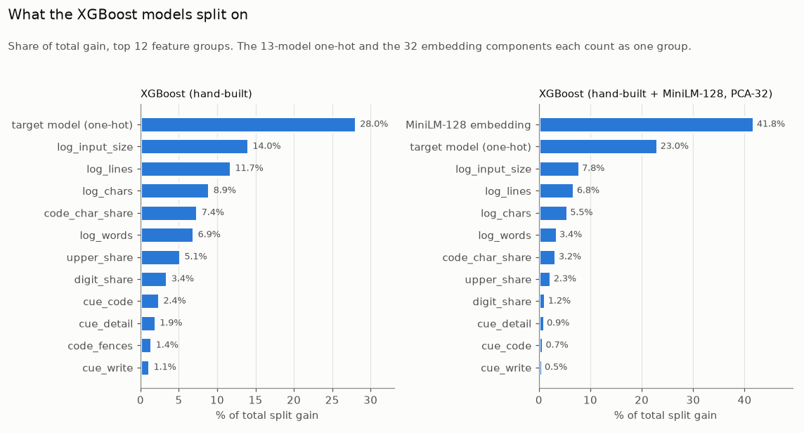

### 15. What the trees use, and who they under-cover

With the embedding, its 32 components take 42% of the total split gain, the model one-hot 23%, and the size features (log input size, lines, characters, words) 24%. Without it, the model one-hot leads (28%), followed by the size features (42% together) and the code-character share (7%). The cue words and length hints get under 2.5% each in both models: the hints fire on too few prompts (finding 8).

Coverage per model at the frozen shift ranges from **93.9% (gemma-3-4b)** to 95.8% (Mistral-7B). The hand-built XGBoost ranges from 94.5% to 96.4%. The embedding model buys part of its saving by under-covering gemma-3-4b, the model with the long second peak (finding 6). That is the risk flagged on Day 3. Day 7 reports it next to the headline number, and the simulator will show whether a 1-point coverage loss on one model matters for overshoot.

## Day 6: Neural network (4 Nov 2026)

**Scope.** Trained on train (sanitized), early-stopped and tuned on validation (sanitized); test is not loaded. The MLP takes the Day-5 inputs (hand-built features, log input size, the 13-model one-hot, and the MiniLM-128 embedding raw or as the Day-5 PCA-32), has two hidden layers (256 and 64, ReLU, dropout) and one output: the 95th percentile of log1p(output tokens). The training loop is hand-written: AdamW on the pinball loss, batches of 512 (prompt, model) samples, learning rate halved after 4 epochs without improvement, stopped after 12, best epoch kept. Completions of a sample share their features, so training runs on 97,825 samples with up to 10 targets each. The loss is the same as one row per completion and 10× cheaper. The knob θ and the 95% tuning are Day 5's. Rebuild with `make mlp` (2 min 20 s on 4 threads, after `make models`); the numbers come from [`figures/mlp_validate.json`](figures/mlp_validate.json).

| Method | Shift θ | Coverage (original) | Validation pinball | Reservation ratio | vs. the bar | Oracle gap closed |
|---|---|---|---|---|---|---|
| Per-model percentile (the bar) | — | 94.85% | — | 2.246 | — | 0% |
| XGBoost (hand-built + MiniLM-128, PCA-32), Day 5 | +0.082 | 94.85% | 0.05688 | 1.815 | −19.2% | 45.9% |
| MLP (hand-built) | +0.020 | 94.85% | 0.05798 | 1.910 | −15.0% | 35.9% |
| MLP (hand-built + raw MiniLM-128) | +0.087 | 94.85% | 0.05826 | 1.880 | −16.3% | 39.1% |
| MLP (hand-built + MiniLM-128 PCA-32) | −0.004 | 94.85% | 0.05447 | 1.804 | −19.7% | 47.2% |
| **MLP (hand-built + MiniLM-128 PCA-32; input dropout 0.2)** | +0.015 | 94.85% | 0.05377 | **1.769** | **−21.2%** | **50.9%** |
| **Average of that MLP and XGBoost, in log space (the winner)** | +0.034 | 94.85% | 0.05392 | **1.756** | **−21.8%** | **52.3%** |
| Average of 3 seeds of the MLP (reference) | −0.001 | 94.85% | 0.05329 | 1.759 | −21.7% | 52.0% |
| Oracle: k × own mean + own std | — | 94.94% | — | 1.309 | −41.7% | 100% |

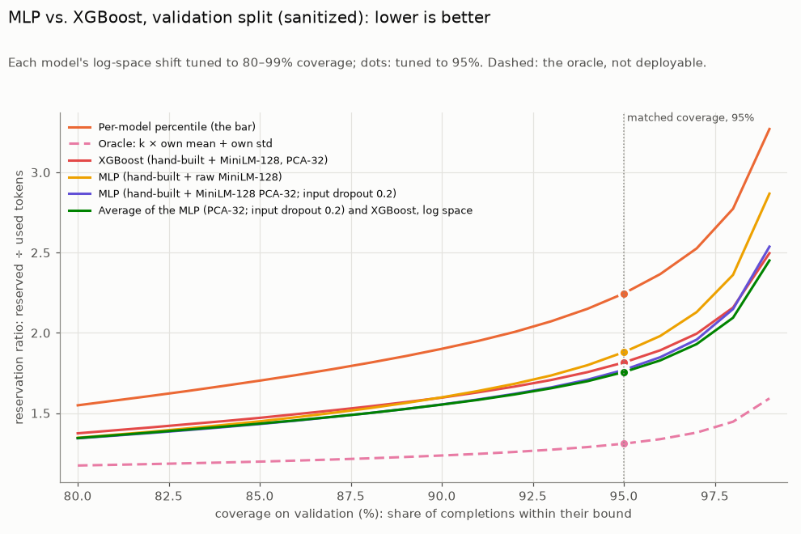

### 16. The MLP beats XGBoost, and averaging the two passes the 20% target on validation

The chosen MLP reserves 1.769× what is used at 95% coverage, against 1.815 for XGBoost and 2.246 for the bar: −21.2%, 51% of the oracle gap. The equal-weight average of the two log predictions does a little better, 1.756 (−21.8%, 52%), and is the winner by the rule fixed before the run (lowest validation ratio among XGBoost, the MLP and their average). The target asks for 1.797 **on test**, so validation leaves 0.041 of margin for Day 7. The lead holds along the curve: the average is at 1.34 vs. 1.37 for XGBoost at 80% coverage, 1.55 vs. 1.60 at 90%, and 2.45 vs. 2.50 at 99%.

The same caveat as Day 5 applies, more strongly: 19 MLP configurations plus 3 candidates were compared on validation, and early stopping and θ use it too.

### 17. The network memorizes prompts in a few epochs; only input dropout stops it

With the raw embedding, validation loss is best after epoch 3 and climbs from there, while train loss keeps falling (0.049 vs. 0.058 at the best epoch). Each train prompt appears 12 times (once per model) with the same 384 values, so the network can recognize the prompt. The usual levers barely move it. Every configuration tried, on validation with seed 0 (the defaults are dropout 0.2 after each hidden layer, weight decay 1e-4, lr 1e-3, batch 512):

| Inputs | Change from the defaults | Best epoch | Validation pinball | Ratio at 95% |
|---|---|---|---|---|
| hand-built | — | 25 | 0.05798 | 1.910 |
| hand-built | input dropout 0.2 | 23 | 0.05901 | 1.897 |
| + raw MiniLM-128 | — | 3 | 0.05826 | 1.880 |
| + raw MiniLM-128 | dropout 0.5 | 11 | 0.05604 | 1.807 |
| + raw MiniLM-128 | dropout 0.7 | 22 | 0.05657 | 1.838 |
| + raw MiniLM-128 | weight decay 0.01 | 2 | 0.05871 | 1.880 |
| + raw MiniLM-128 | weight decay 0.1 | 3 | 0.05789 | 1.874 |
| + raw MiniLM-128 | lr 1e-4 | 4 | 0.05828 | 1.907 |
| + raw MiniLM-128 | batch 4,096 | 2 | 0.05826 | 1.898 |
| + raw MiniLM-128 | input dropout 0.3, dropout 0.5 | 18 | 0.05477 | 1.792 |
| + raw MiniLM-128 | input dropout 0.5 | 21 | 0.05493 | 1.802 |
| + PCA-32 | — | 5 | 0.05447 | 1.804 |
| + PCA-32 | dropout 0.5 | 17 | 0.05491 | 1.817 |
| + PCA-32 | dropout 0.3, weight decay 0.01 | 7 | 0.05437 | 1.799 |
| + PCA-32 | input dropout 0.1 | 28 | 0.05377 | 1.781 |
| **+ PCA-32** | **input dropout 0.2** | **49** | **0.05377** | **1.769** |
| + PCA-32 | input dropout 0.3 | 56 | 0.05393 | 1.766 |
| + PCA-32 | input dropout 0.4 | 35 | 0.05495 | 1.786 |
| + PCA-32 | input dropout 0.2, dropout 0 | 9 | 0.05409 | 1.808 |

Two changes do the work, and they add up. The Day-5 PCA helps the network as it helped the trees (1.880 → 1.804). Dropout on the inputs, which hides a random 20% of the features from every step, stops the network from keying on a prompt's exact coordinates: with it, training runs 49 epochs and train and validation loss stay level. Weight decay, a lower learning rate and bigger batches only stop training earlier. Input dropout 0.1–0.3 is a plateau, and 0.2 is frozen: it ties 0.1 on pinball loss with a better ratio, and 0.3's lead (0.003) is below the seed noise below. Hidden dropout still matters next to input dropout (1.808 without it).

The MLP on hand-built features alone is no better than XGBoost on them (1.910 vs. 1.903). So the gain is not the prompt × model interaction that finding 2 asked for, since the trees model interactions too. It comes from using the embedding as a smooth input instead of something to split on.

### 18. Seed noise is about ±0.01, and most of the average's gain is variance reduction

The chosen configuration retrained with seeds 0, 1 and 2 gives 1.769, 1.772 and 1.772. Without input dropout the spread is wider: 1.787–1.807. Differences under about 0.01 between single runs are not findings. Seed 0 is the frozen model.

Averaging the three seeds gives 1.759, almost all of the 0.013 the MLP + XGBoost average gains over the MLP alone. Most of the winner's edge is averaging out noise, not XGBoost knowing something the MLP doesn't. Averaging seeds would serve three MLPs and is not a candidate; the MLP + XGBoost average was the pre-registered one and is kept. Serving it means two small regressors after one embedding. The embedding is most of the 15 ms budget, so Day 11 exports both.

### 19. The MLP is close to calibrated, and evens out coverage per model

The MLP needs a shift of only +0.015 to reach 95% on validation, against +0.082 for XGBoost (finding 12): its raw 95th-percentile predictions run about 1.5% low on unseen prompts instead of 8–9%. Coverage per model at the frozen shift:

| Model | Lowest per-model coverage | Highest |
|---|---|---|
| XGBoost | 93.87% (gemma-3-4b) | 95.80% (Mistral-7B) |
| MLP | 94.34% (Ministral-8B) | 95.84% (Qwen2.5-32B) |
| Average (the winner) | 94.48% (gemma-3-4b) | 95.67% (Qwen2.5-32B) |

The average lifts gemma-3-4b from 93.9% to 94.5% and has the narrowest range of the three. Day 7 reports the per-model table on test next to the headline number.

### 20. torch and xgboost can't run in one process on macOS

Each wheel ships its own OpenMP runtime. In one Python process, xgboost segfaults if torch loaded first, and multi-threaded torch deadlocks if xgboost loaded first. So `make models` saves the XGBoost validation predictions (`data/models/xgb_minilm128_validate_pred.npz`) and `make mlp` reads them without running xgboost. That file was first written by a separate run of the same code: `make models` has not been rerun since the change. `tests/conftest.py` loads xgboost first and keeps torch on one thread, the one combination that works. **So:** Day 7 scores test the same way (XGBoost in one process, the MLP in another), and serving avoids the problem, since ONNX Runtime replaces both libraries on Day 11.

## Day 7: Test, scored once (4 Nov 2026)

**Scope.** The test split, read for the first time and scored once: 1,130 prompts, 140,276 sanitized completions (140,480 original), mean length 413. Every knob comes from validation and is read back, never re-tuned: each baseline's percentile (Day 3), each model's log-space shift (Days 5 and 6), and the winner, the average of the MLP and XGBoost log predictions (Day 6). The models are loaded from `data/models/` and must reproduce their validation ratios to within 10⁻⁶ before any test prediction is written. All five do, and the saved XGBoost reproduces the validation predictions Day 6 averaged, which closes the open point in finding 20. Rebuild with `make eval` (4 min 20 s, almost all of it the leave-one-dataset-out training; a second run reproduces every number exactly). The numbers come from [`figures/test_results.json`](figures/test_results.json).

The frozen protocol is the headline: each method keeps its validation knob, so its test coverage lands near 95% but not on it. Two diagnostics sit next to it and choose nothing. "Matched on test" re-tunes every knob to exactly 95% on test, so a saving can't come from covering less. A bootstrap over whole prompts gives intervals for the frozen numbers. The oracle reads the lengths it bounds, so its k is tuned on test, as it was on validation.

| Method | Deployable | Frozen knob θ | Coverage (sanitized) | Coverage (original) | Reservation ratio | vs. the bar | Oracle gap closed | Ratio matched on test | vs. the bar, matched |
|---|---|---|---|---|---|---|---|---|---|
| `max_tokens` = 4,096 | yes | — | 99.93% | 99.79% | 9.916 | +328.7% | — | — | — |
| Global percentile | yes | 0.9463 | 95.51% | 95.37% | 2.368 | +2.4% | −5.5% | 2.281 | +3.5% |
| **Per-model percentile (the bar)** | yes | 0.9539 | 96.05% | 95.91% | **2.313** | — | 0% | **2.203** | — |
| Per-model × input-length quintile | yes | 0.9529 | 95.79% | 95.65% | 2.197 | −5.0% | 11.5% | 2.111 | −4.1% |
| Per-model × source dataset | no | 0.9535 | 95.56% | 95.42% | 2.048 | −11.4% | 26.3% | 2.002 | −9.1% |
| Linear quantile regression (hand-built) | yes | +0.017 | 95.55% | 95.42% | 2.258 | −2.4% | 5.5% | 2.205 | +0.1% |
| XGBoost (hand-built) | yes | +0.043 | 95.40% | 95.26% | 1.938 | −16.2% | 37.4% | 1.906 | −13.5% |
| XGBoost (hand-built + MiniLM-128 PCA-32) | yes | +0.082 | 95.74% | 95.60% | 1.872 | −19.1% | 43.9% | 1.815 | −17.6% |
| MLP (hand-built + MiniLM-128 PCA-32) | yes | +0.015 | 95.81% | 95.67% | 1.821 | −21.3% | 49.0% | 1.766 | −19.8% |
| **Average of the MLP and XGBoost (the winner)** | yes | +0.034 | 95.81% | 95.67% | **1.808** | **−21.8%** | **50.3%** | **1.753** | **−20.4%** |
| Oracle: k × own mean + own std | no | tuned on test | 95.00% | 94.97% | 1.309 | −43.4% | 100% | 1.309 | −40.6% |

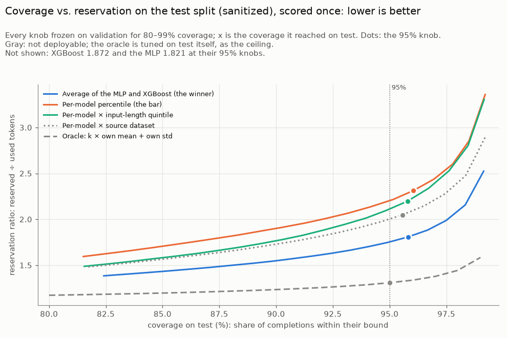

### 21. The winner meets the 20% target on test: −21.8% against the bar, −20.4% at equal coverage

At its frozen shift the winner reserves 1.808× what is used, at 95.81% coverage. The bar reserves 2.313× at 96.05%. That is 21.8% fewer tokens and 50% of the gap to the oracle. With both re-tuned to exactly 95% on test, the winner reserves 1.753 against 2.203: −20.4%, still 50% of the gap. Resampling whole prompts 2,000 times puts the frozen saving between −23.3% and −20.3% (95% interval), and 98.8% of resamples reach −20%. Against `max_tokens` = 4,096 the winner reserves 82% fewer tokens. The lead holds along the whole curve.

Three things to read with it:

- **The Day-3 figure of 1.797 does not carry over.** It was 80% of the *validation* bar (2.246). The target is relative to the bar on the same split. Test is about 2% shorter than validation (mean 413 vs. 421 tokens, p95 942 vs. 978), so every frozen knob over-covers by 0.4–1.1 points, and the bar costs 2.313 at its frozen percentile. The winner's 1.808 is above 1.797 and below 80% of the test bar (1.850).
- **The margin at equal coverage is thin.** −20.4% clears the target by 0.4 points, and the bootstrap's lower end (−20.3%) only just does. The MLP alone sits on the line (−19.8% matched, −21.3% frozen), and XGBoost alone misses (−17.6% and −19.1%). The average that Day 6 picked before seeing test is what passes.
- **Validation did not flatter the models.** Re-tuned to 95% on test, the winner, the MLP and XGBoost reserve 1.753, 1.766 and 1.815, against 1.756, 1.769 and 1.815 on validation, even though 19 MLP and 12 XGBoost configurations were compared on validation. The bar got cheaper instead (2.246 → 2.203), which is why the relative saving shrinks from −21.8% to −20.4%. At the frozen knobs, every method ranks as it did on validation.

On the original config, degenerate completions included, every percentile and model loses 0.13–0.14 points of coverage (0.15 on validation): the winner covers 95.67%.

### 22. Coverage holds for every model and every prompt length, but not for every kind of prompt

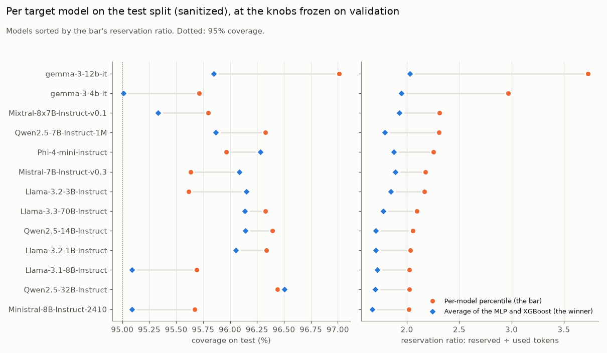

| Target model | Rows | Bar coverage | Bar ratio | Winner coverage | Winner ratio | Change vs. the bar |
|---|---|---|---|---|---|---|
| Llama-3.1-8B-Instruct | 10,994 | 95.69% | 2.024 | 95.09% | 1.717 | −15.2% |
| Llama-3.2-1B-Instruct | 10,945 | 96.34% | 2.035 | 96.05% | 1.703 | −16.3% |
| Llama-3.2-3B-Instruct | 11,021 | 95.62% | 2.168 | 96.15% | 1.844 | −14.9% |
| Llama-3.3-70B-Instruct | 11,029 | 96.33% | 2.096 | 96.14% | 1.776 | −15.3% |
| Ministral-8B-Instruct-2410 | 11,040 | 95.67% | 2.020 | 95.09% | 1.667 | −17.5% |
| Mistral-7B-Instruct-v0.3 | 11,040 | 95.63% | 2.176 | 96.09% | 1.890 | −13.2% |
| Mixtral-8x7B-Instruct-v0.1 | 11,035 | 95.80% | 2.311 | 95.33% | 1.925 | −16.7% |
| Phi-4-mini-instruct | 11,028 | 95.96% | 2.255 | 96.28% | 1.873 | −17.0% |
| Qwen2.5-14B-Instruct | 11,040 | 96.39% | 2.059 | 96.14% | 1.700 | −17.4% |
| Qwen2.5-32B-Instruct | 11,037 | 96.44% | 2.022 | 96.50% | 1.696 | −16.1% |
| Qwen2.5-7B-Instruct-1M | 11,027 | 96.33% | 2.306 | 95.86% | 1.786 | −22.5% |
| gemma-3-12b-it | 8,000 | 97.01% | 3.730 | 95.85% | 2.026 | **−45.7%** |
| gemma-3-4b-it | 11,040 | 95.72% | 2.966 | 95.01% | 1.948 | **−34.3%** |

Every target model ends up between 95.0% and 96.5% coverage, and the winner saves on every one: 13–23% on the eleven similar models, and **46% and 34% on the two gemma models**, whose long second peak (finding 2) the bar covers with one bound for every prompt. gemma-3-4b, which XGBoost under-covered at 93.9% on validation (finding 15), is at 95.0%. So the saving is not bought by quietly under-covering one model, the risk flagged on Day 3.

Per source dataset it is a different story:

| Source dataset | Rows | Bar coverage | Bar ratio | Winner coverage | Winner ratio | Change vs. the bar |
|---|---|---|---|---|---|---|
| Alpaca | 24,973 | 96.59% | 2.688 | 95.63% | 1.972 | −26.6% |
| Apps | 24,869 | 93.43% | 1.816 | 95.76% | 1.689 | −7.0% |
| BigCodeBench | 14,813 | 99.42% | 2.190 | 97.41% | 1.525 | −30.4% |
| DS1000 | 12,996 | 99.60% | 3.006 | 97.32% | 1.803 | −40.0% |
| DollyDataset | 25,978 | 99.46% | 3.193 | 98.27% | 2.250 | −29.5% |
| Mbpp | 12,737 | 99.76% | 3.076 | 96.33% | 1.735 | −43.6% |
| ShareGPT | 23,910 | 88.52% | 1.649 | **91.31%** | 1.719 | **+4.2%** |

The winner's coverage runs from **91.3% on ShareGPT to 98.3% on Dolly**. On ShareGPT it reserves 4% more than the bar and still covers less than 95% (the bar covers only 88.5% there). So 95% overall is an average over kinds of traffic: open-ended chat gets bounds that are too low, and short-answer instructions and code get bounds that are too high. Prompt length no longer matters the same way. The winner covers 95.0–96.8% of every input-length quintile, where the bar ranges from 92.9% to 98.3%:

| Prompt tokens (train quintiles) | Rows | Bar coverage | Bar ratio | Winner coverage | Winner ratio | Change vs. the bar |
|---|---|---|---|---|---|---|
| < 38 | 27,775 | 95.52% | 2.356 | 94.96% | 1.901 | −19.3% |
| 38–68 | 28,082 | 95.96% | 2.381 | 95.40% | 1.878 | −21.1% |
| 68–157 | 26,964 | 97.63% | 2.670 | 96.81% | 1.755 | −34.3% |
| 157–336 | 28,710 | 98.28% | 2.473 | 96.25% | 1.740 | −29.7% |
| ≥ 336 | 28,745 | 92.94% | 1.867 | 95.68% | 1.768 | −5.3% |

**So:** the simulator (Day 8) should report overshoot per source dataset as well as per model. ShareGPT-like traffic is where reservations will run short.

### 23. Three quarters of the worst misses are runaways and lone long runs, which no prompt-only bound can see

The 100 worst under-predictions are ranked by (y − bound) ÷ bound, taking each (prompt, model) sample's worst completion once; they come from 59 prompts. Each is assigned the first cause its numbers match:

| Cause (rules applied in this order) | Count | Prompts | Median miss, y ÷ bound − 1 |
|---|---|---|---|
| Runaway: the completion is past `max_tokens` = 4,096, and the sanitized config kept it | 53 | 37 | 5.98 |
| Lone long run: the sample's median completion is within the bound | 21 | 20 | 2.23 |
| Prompt misread: the median is over the bound, and so it is for at least half of the other LLMs on the prompt | 16 | 5 | 2.23 |
| This LLM, not the prompt: the median is over the bound, but most other LLMs stayed within theirs | 10 | 9 | 2.10 |

The rules were written after looking at the misses, as error analysis is; they choose nothing.

- **Runaways (53):** completions of 4,190–14,247 tokens, mostly one or two runs in an otherwise normal sample (the sample's median is past 4,096 in only 4). CASTILLO's degenerate rule needs a completion at 15,000 or a sample with std > 2 × mean and a max of at least 8,500, so it misses these. A gateway's `max_tokens` cuts them off.
- **Lone long runs (21):** the bound fits the typical answer and one run goes 2–4× longer. With the runaways, that is 74 of the 100: the within-prompt spread of finding 4. The worst samples have a median CV of 0.84, against 0.16 for all samples, which answers finding 4's question: under-predictions are concentrated in high-spread samples.
- **Prompt misread (16, from 5 prompts):** open-ended requests whose length the bound under-reads for most LLMs. "Give me a list of people who have won the Nobel Prize in Physics" gets bounds of 571–1,078 and medians up to 3,461. "Create a worksheet with 25 sentences…" gets 327–506 (a sentence count usually means a short answer, finding 8). The others are a MySQL schema exercise, a three-function Apps task and "Design a chess playing AI". 7 of the 16 have a length hint.
- **This LLM, not the prompt (10, 9 prompts):** one LLM answers at length where the others don't, mostly Mixtral and Mistral on ShareGPT and Alpaca (a story, a poem in the style of "The Raven", a how-to written "as a textbook").

Five models give 75 of the 100 (Llama-3.2-1B 23, Mixtral-8x7B 17, Phi-4-mini 14, Llama-3.2-3B 11, Llama-3.1-8B 10) but only 39% of the samples. They are the same models that produce most degenerate runs (finding 5). By dataset: ShareGPT 40, Apps 24, Alpaca 23.

**On the original config,** the winner misses 6,076 completions (4.3%) at its frozen shift. All 204 degenerate completions are among them, and they carry **59% of the tokens over the bound**. Clipped at `max_tokens`, as a gateway bills, they carry 27%, and total overshoot is 3.9% of used tokens (the bar: 4.3%). **So:** Day 10 sizes the overdraft buffer from the clipped overshoot, broken down per model, since five models account for most of it.

### 24. On a benchmark the model never saw, half the gain is gone

The embedding recognizes CASTILLO's prompt templates (finding 10), so each of the 7 source datasets was held out in turn. The winner's design was retrained without it everywhere it could leak in (the PCA, both models' training rows and early stopping), its shift tuned on validation outside it, and it was scored on the held-out dataset's test prompts. "Bar" is the per-model percentile fitted without the dataset. The frozen winner ("full") is compared with the bar fitted on all of train, which is 0.01–0.07 cheaper. "Ratio at 95%" re-tunes every method to 95% on the dataset's own test rows, so it compares how well they rank its prompts.

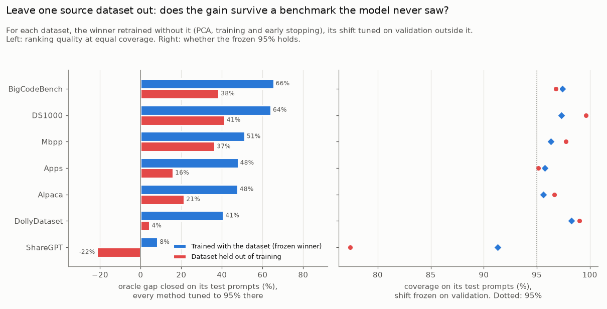

| Held-out dataset | Test prompts | Coverage, frozen: bar / full / held out | Ratio at 95% on the dataset: bar / full / held out / oracle | vs. the bar: full / held out | Gap closed: full / held out |
|---|---|---|---|---|---|
| Alpaca | 200 | 97.0% / 95.6% / 96.6% | 2.503 / 1.916 / 2.241 / 1.281 | −23.3% / −10.5% | 48% / 21% |
| Apps | 210 | 91.1% / 95.8% / 95.2% | 1.968 / 1.646 / 1.871 / 1.359 | −13.8% / −5.0% | 48% / 16% |
| BigCodeBench | 114 | 99.5% / 97.4% / 96.8% | 1.804 / 1.428 / 1.587 / 1.240 | −20.0% / −12.0% | 66% / 38% |
| DS1000 | 100 | 99.7% / 97.3% / 99.6% | 2.186 / 1.649 / 1.844 / 1.358 | −23.9% / −15.7% | 64% / 41% |
| DollyDataset | 200 | 99.6% / 98.3% / 99.0% | 2.486 / 1.986 / 2.432 / 1.274 | −19.8% / −2.2% | 41% / 4% |
| Mbpp | 98 | 99.8% / 96.3% / 97.7% | 2.054 / 1.660 / 1.780 / 1.302 | −18.5% / −13.4% | 51% / 37% |
| ShareGPT | 208 | 81.5% / 91.3% / 77.4% | 2.104 / 1.979 / 2.272 / 1.326 | −2.9% / **+8.0%** | 8% / **−22%** |

| Training data | Coverage, frozen | Ratio at 95% | vs. the bar at 95% | Oracle gap closed |
|---|---|---|---|---|
| All of train (the frozen winner) | 95.81% | 1.753 | −20.4% | 50% |
| A random seventh of the train prompts removed (control) | 95.81% | 1.760 | −20.1% | 50% |
| Each row's own dataset removed (all 7 held-out runs, pooled) | **93.94%** | 2.126 | **−9.3%** | **21%** |

Held out of training, the winner still beats its bar on 6 of the 7 datasets, but by 2–16% instead of 14–24%, closing 4–41% of the oracle gap instead of 41–66%. On ShareGPT it does worse than the bar (+8.0%). Pooled, with every test row scored by the model that never saw its dataset and each run keeping its own frozen shift, the saving is **−9.3% at equal coverage (−12.0% frozen) and 21% of the oracle gap**, against −20.4% and 50% with every dataset in training. That is about what knowing the source dataset buys (−9.1%, the not-deployable reference row).

**It is not the smaller training set.** Holding out a dataset leaves 795k–889k of the 977k train rows. The control removes a random seventh of the train prompts from every dataset (836k rows left), and it keeps −20.1% and 50% of the gap.

**Calibration doesn't transfer either.** With the shift frozen on validation outside the dataset, coverage on the held-out dataset runs from **77.4% (ShareGPT)** to 99.6% (DS1000), and 93.9% pooled. ShareGPT is the worst case on both counts, and it is real user chat, the closest of the seven to gateway traffic. The trees transfer better than the network: held out, XGBoost ranks prompts better than the MLP on 4 of the 7 datasets (Apps 1.840 vs. 2.033, ShareGPT 2.271 vs. 2.397), while with every dataset in training the MLP is better on all 7.

**So:** "the model learned what prompts ask for" is half true. It keeps a real gain on 6 of 7 benchmarks it never saw, but about half of its test gain comes from recognizing CASTILLO's seven templates. The −21.8% headline is for CASTILLO-like traffic. On a new kind of prompt, expect about −10% and a coverage shortfall until the quantile is re-tuned on that traffic. This goes in the README next to the headline. Day 10's overdraft buffer has to absorb a coverage drop on unfamiliar traffic, not just runaways, and the January plan's online adaptation of the quantile (v2 item 3) moves from a nice-to-have to the fix for this.

**Gate: model frozen.** The served model is Day 6's average of `mlp.pt` and `xgb_minilm128.ubj`, both on `pca_minilm128_32.npz`, with the shift +0.034 from `data/models/manifest.json`. Their sha256 hashes are in `test_results.json`, so Days 8–13 can check they serve what test scored. Nothing changes from here on because of a test number.

## Day 8: Simulator core (4 Nov 2026)

**Scope.** A discrete-event simulator of a budget gateway (`src/llm_reserve/simulate.py`), run end to end with the `max_tokens` policy. A `heapq` loop processes arrival and completion events. Requests arrive as a Poisson process; each is a test (prompt, model) sample drawn uniformly, and what it actually produces is one of its 10 completions drawn uniformly from the **`original` config, degenerate runs included**. Each request carries `max_tokens` = 4,096, so its real cost is input + min(y, 4,096). The gateway holds **200,000 tokens per fixed one-minute window**. A request is admitted if input + min(bound, 4,096) fits in what is left of the window, else it gets a 429 and is dropped (no retries). It runs for output tokens ÷ 50 tokens per second, then settles: its window is charged the real cost instead of the reservation. This is the Day-12 Redis design (reserve with `INCRBY` on the window's key, settle with `INCRBY` by actual − reserved on the same key), so a request that finishes after its window closed is still billed to the window that admitted it. Every policy runs on the same trace. Rebuild with `make sim` (about 1 second); the numbers come from [`figures/sim_max_tokens.json`](figures/sim_max_tokens.json).

Default run: 4 requests per second for 60 minutes, which is 76.7% of the budget in real cost if every request got in (mean cost 639 tokens: 223 input, 416 output after clipping). Means over 3 seeds:

| Policy | Requests | Admitted | Rejected (429) | Admit rate | Truncated at `max_tokens` | Windows over budget | Largest overshoot | Real spend ÷ budget | Reserved ÷ used |
|---|---|---|---|---|---|---|---|---|---|
| `max_tokens` = 4,096 | 14,489 | 12,075 | 2,414 | 83.3% | 24.7 | 0 | 0.00% | 63.5% | 6.84 |

Per seed: 12,040 / 12,039 / 12,147 admitted out of 14,468 / 14,452 / 14,547.

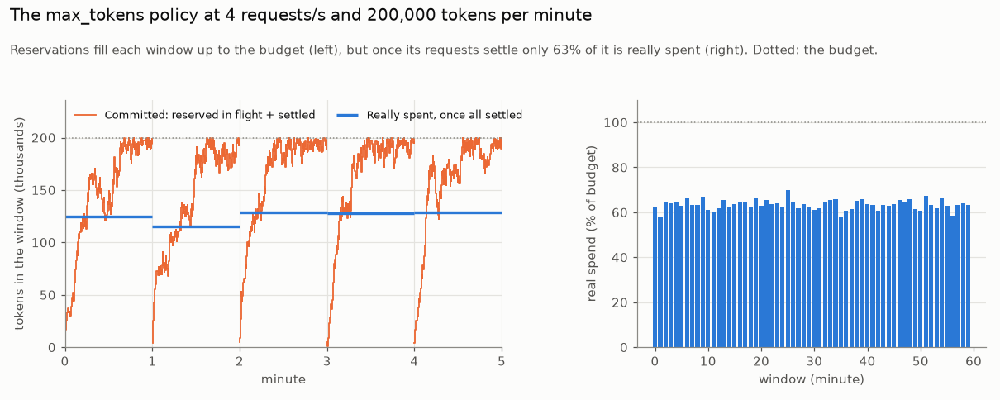

### 25. Worst-case reservations turn away 1 request in 6 while a third of the budget goes unspent

Reservations fill each window to the budget fast: the first 429 comes a median 28 seconds into the minute (14–40 s, seed 0), and from then on the gateway turns away whatever does not fit. But once the window's requests settle, only **63.5% of the budget was really spent**: reserved tokens are 6.84× the tokens used (input included; on output alone the offline ratio was 9.9). So 16.7% of requests are rejected by a gateway that would have had room for all of them: demand was 76.7% of the budget. This is the problem the PRD describes, reproduced on CASTILLO's real lengths. At most 48 requests are in flight at once, about 200,000 ÷ 4,319 (the mean reservation): the budget, not the arrivals, caps concurrency.

**`max_tokens` never overshoots**, by construction: no request can cost more than its reservation once the provider stops at 4,096. About 25 admitted requests per run (0.2%) are cut off there; those are the runaways of finding 23. So the overshoot columns are all zero today and become informative on Day 9, when bounds below `max_tokens` can be beaten. The simulator already sums under-reserved tokens (actual − reserved, when positive) per target model and per source dataset, which is where Day 7 said to look (finding 22).

### 26. The admit rate depends on decode speed as much as on the budget

Settling is what gives budget back: a request that reserved 4,319 tokens and used 639 frees the difference only when it finishes. So the decode speed decides how much of each window is locked in reservations at any moment. One knob at a time, 3 seeds each, `max_tokens` policy:

| Setting | Admit rate | Real spend ÷ budget | Demand ÷ budget |
|---|---|---|---|
| 25 tokens/s | 61.3% | 46.2% | 76.7% |
| **50 tokens/s (default)** | **83.3%** | **63.5%** | **76.7%** |
| 100 tokens/s | 95.8% | 73.4% | 76.7% |
| 2 requests/s | 100.0% | 38.7% | 38.7% |
| **4 requests/s (default)** | **83.3%** | **63.5%** | **76.7%** |
| 8 requests/s | 46.2% | 69.4% | 153.4% |

Halving the decode speed costs `max_tokens` 22 points of admit rate; doubling it gains 12. At 2 requests per second the budget never binds and every policy will admit everything. At 8, demand is 1.5× the budget, so even a perfect predictor must reject a third of the requests. **So:** Day 9 sweeps the arrival rate and the budget as planned, and also reports the result at 25 and 100 tokens per second. A learned policy's edge is largest when requests are slow, because that is when an oversized reservation is held longest. The 50 tokens/s default is an assumption, not a measurement: CASTILLO's `gen_time` column is label-derived and never read (Day 1).

### 27. Under worst-case reservations every kind of request is equally likely to be turned away

The admit rate is 82.2–84.0% for every source dataset and 82.1–84.6% for every target model. `max_tokens` reserves the same 4,096 output tokens for everyone, so the only difference is the input length (Apps has the longest prompts and the lowest rate). **So:** Day 9 reports the learned policy's admit rate per dataset and per model next to its totals. A policy that reserves by predicted length will admit short requests more readily than long ones, and that is a fairness cost worth showing, not hiding.

## Day 9: Policies and sweeps (4 Nov 2026)

**Scope.** Every reservation policy in the Day-8 simulator (`src/llm_reserve/sweep.py`): `max_tokens`, the global and per-model p95 (the bar), the frozen winner (MLP + XGBoost average), and the oracle as a ceiling. Nothing is tuned. Each bound is computed on the test split's `original` config at the knob Day 7 scored, and must reproduce Day 7's coverage and reservation ratio there to 1e-9 before any simulation runs (it does for all five). The winner comes from the predictions `make eval` saved, so this process never loads torch. A new metric, **wrongful rejection**, counts 429s whose real cost would have fit in what was left of the window at that moment: the gateway turned the request away only because of the size of its reservation. The grid is arrival rate (1–16 requests/s) × budget (100k, 200k, 400k tokens per minute) at 50 tokens/s, plus arrival rate × decode speed (25, 50, 100 tokens/s) at 200k: 35 settings, 3 seeds each, every policy on the same traces. Rebuild with `make sweep` (about 25 seconds, one core); the numbers come from [`figures/sim_policies.json`](figures/sim_policies.json).

Default setting (4 requests/s, 200,000 tokens per minute, 50 tokens/s), means over 3 seeds:

| Policy | Admitted | Admit rate | ÷ `max_tokens` | ÷ per-model p95 | Wrongful 429s | Windows over budget | Largest overshoot | Real spend ÷ budget | Reserved ÷ used |
|---|---|---|---|---|---|---|---|---|---|
| `max_tokens` = 4,096 | 12,075 | 83.3% | 1.000× | 0.833× | 2,074 | 0 | 0.00% | 63.5% | 6.84 |
| Global p95 | 14,489 | 100.0% | 1.200× | 1.000× | 0 | 0 | 0.00% | 76.7% | 1.88 |
| Per-model p95 (the bar) | 14,489 | 100.0% | 1.200× | 1.000× | 0 | 0 | 0.00% | 76.7% | 1.85 |
| **Learned bound (the winner)** | **14,489** | **100.0%** | **1.200×** | **1.000×** | **0** | **0** | **0.00%** | **76.7%** | **1.52** |
| Oracle (not deployable) | 14,489 | 100.0% | 1.200× | 1.000× | 0 | 0 | 0.00% | 76.7% | 1.24 |

Overloaded setting (8 requests/s, the same budget and speed; demand is 153% of the budget):

| Policy | Admitted | Admit rate | ÷ `max_tokens` | ÷ per-model p95 | Wrongful 429s | Windows over budget | Largest overshoot | Real spend ÷ budget | Mean admitted cost |
|---|---|---|---|---|---|---|---|---|---|
| `max_tokens` = 4,096 | 13,377 | 46.2% | 1.000× | 0.689× | 13,244 | 0 | 0.00% | 69.4% | 622 |
| Global p95 | 19,437 | 67.1% | 1.453× | 1.000× | 4,135 | 40.0 of 60 | 6.09% | 101.0% | 624 |
| Per-model p95 (the bar) | 19,428 | 67.1% | 1.452× | 1.000× | 3,909 | 36.7 of 60 | 5.74% | 100.6% | 622 |
| **Learned bound (the winner)** | **19,953** | **68.9%** | **1.492×** | **1.027×** | **2,414** | **39.0 of 60** | **5.64%** | **100.9%** | **607** |
| Oracle (not deployable) | 20,140 | 69.6% | 1.506× | 1.037× | 635 | 6.0 of 60 | 0.61% | 99.6% | 593 |

Across seeds the winner ÷ bar ratio at 8 requests/s is 1.025–1.029, so the ordering is not noise.

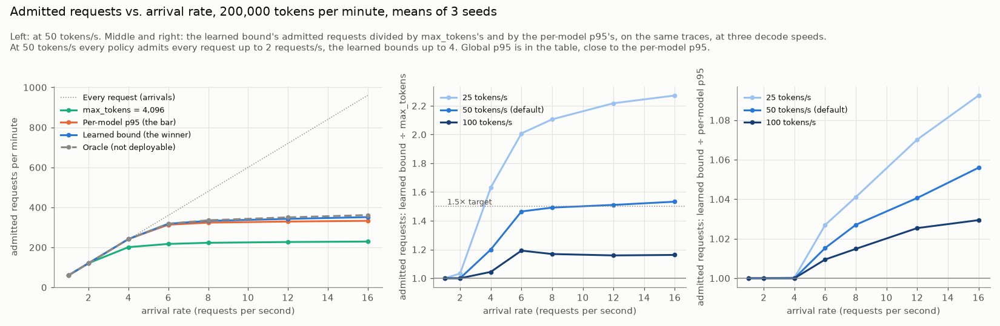

The winner's admit rate across the grid (the full table, with every policy, is printed by `make sweep`):

| Setting | 1 | 2 | 4 | 6 | 8 | 12 | 16 requests/s |
|---|---|---|---|---|---|---|---|
| Winner ÷ `max_tokens`, 100k budget | 1.00× | 1.25× | 1.52× | 1.54× | 1.56× | 1.61× | 1.66× |
| Winner ÷ `max_tokens`, 200k budget | 1.00× | 1.00× | 1.20× | 1.46× | 1.49× | 1.51× | 1.53× |
| Winner ÷ `max_tokens`, 400k budget | 1.00× | 1.00× | 1.00× | 1.02× | 1.18× | 1.44× | 1.47× |
| Winner ÷ `max_tokens`, 200k, 25 tokens/s | 1.00× | 1.03× | 1.63× | 2.01× | 2.11× | 2.22× | 2.27× |
| Winner ÷ `max_tokens`, 200k, 100 tokens/s | 1.00× | 1.00× | 1.04× | 1.19× | 1.17× | 1.16× | 1.16× |
| Winner ÷ the bar, 200k budget | 1.000× | 1.000× | 1.000× | 1.015× | 1.027× | 1.041× | 1.056× |

### 28. The 1.5× target over `max_tokens` is met only past saturation, and the per-model p95 gets most of the way there

At the default setting every policy except `max_tokens` admits every request, so the learned bound is 1.20× `max_tokens`: that is all the room there is (demand is 76.7% of the budget). The PRD's ≥1.5× is reached once demand is about 1.5–2.3× the budget at 50 tokens/s (from 4 requests/s at 100k, from 12 at 200k, never within 16 at 400k), at every overloaded setting at 25 tokens/s (up to 2.27×), and **never at 100 tokens/s** (at most 1.19×), because fast decoding returns `max_tokens`'s oversized reservations before they cost much. So the target holds for slow or overloaded gateways, not in general, and the README must say which.

**Most of the gain is the per-model p95's, not the model's.** The bar alone is 1.45× `max_tokens` at 8 requests/s; the winner adds 2.7% on top. Reserving a p95 instead of the worst case is what fixes `max_tokens`'s problem (finding 25): 85% of `max_tokens`'s 429s are wrongful, at the default and under overload alike.

### 29. Where the budget binds, the winner admits 1–10% more than the bar, mostly by admitting cheaper requests

Below saturation the winner and the bar admit exactly the same requests, since both fit everything: the 22% offline saving in reserved tokens (finding 21) buys nothing until the budget binds. Above it, the winner admits 1.5–5.6% more requests than the bar at 200k and 50 tokens/s, up to 9.2% at 25 tokens/s and 10.1% at 100k. It also halves wrongful 429s (0.47–0.65× the bar's).

But the extra requests are not extra spend. In every overloaded setting both policies drive real spend to about 100% of the budget, and the winner's is only 0.1–1.3% higher. The rest of its edge, 1–10%, is that the requests it admits are cheaper (607 vs. 622 tokens each at 8 requests/s): a tight bound makes a request look cheap when it is, so short requests fill the gaps a window has left. So measured in tokens served, the winner and the bar are within about 1% once the budget binds; measured in requests, the winner wins by up to 10%, and that difference is a choice about which requests to serve (finding 31), not a larger budget.

### 30. Once the budget binds, every policy below `max_tokens` overshoots it, by up to 9% of a window

At the default setting no window overshoots, because real spend stays at 76.7%. But in all 19 of the 35 settings where the budget binds, the global p95, the bar and the winner overshoot in most windows (37–40 of 60 at 8 requests/s), by up to 5.6–6.1% of the budget at 8 requests/s and 8.5–8.8% at its worst (100k, 12 requests/s). The winner is no worse than the bar: they cover about the same 95.7–95.9% of completions on the original config, and once reservations fill a window to the budget every under-reservation becomes overshoot. Even the oracle reaches 2.2%. **The PRD's overshoot ≤1% of a window is not met by any learned policy under overload.** This is what Day 10's two strategies are for: capping `max_tokens` at the bound (zero overshoot, some truncation) or an overdraft buffer sized from the expected misses.

### 31. The winner evens out admission across target models but widens it across kinds of prompt

At 8 requests/s the bar admits the two Gemma models at 61.4% and 61.9% and every other model at 66–69%, because their per-model p95 is the highest (1,792 and 1,368 on train: terse on code, verbose on chat, finding 2), so every Gemma request reserves a lot. The winner admits every model at 66.3–70.1%: it reserves for the prompt, not the model. Across source datasets it goes the other way: the bar spans 63.5–69.4%, the winner 63.2% (Apps, long code answers) to 73.3% (Alpaca, short ones), and the oracle 62.9–76.5%. A tighter bound favours requests that are cheap to serve. That is the right call for a gateway maximizing requests per budget, but it is a choice, and it should be a flag, not a side effect: in the overloaded case, a user asking for long code solutions gets turned away more often than one asking a short question. `max_tokens` treats every request the same (44.0–47.5% per dataset) only because it over-reserves for all of them.

## Day 10: Misprediction strategies (4 Nov 2026)

**Scope.** Two things the gateway can do when a request outruns its bound (`src/llm_reserve/mispredict.py`), applied to the bar (per-model p95) and the winner alike, on the same traces as Day 9. **A, cap:** each request is sent with `max_tokens` = ceil(bound × margin) and reserves exactly that, so it can never cost more than it reserved; overshoot is zero by construction (asserted on every run), and the price is truncation. **B, overdraft buffer:** a share of every window is kept out of admission, and requests that outrun their reservation spend into it; overshoot is still measured against the whole budget. Truncation is split into degenerate completions (runaways and repetition loops, cut at no loss) and **real answers**. Overshoot is the PRD's measure: the largest of any window in any run, so the worst seed, not the mean over seeds (Day 9's 8.8% was a mean; the worst single run unprotected is 10.6–10.9%).

Both knobs are chosen on **validation**, with different seeds (10–12) from test (0–2), before test is simulated. The bounds reproduce each method's frozen validation coverage and ratio to 1e-6. **A's margin** is the smallest of 1, 1.25, 1.5, 2 and 3 that cuts at most 1% of real answers on validation (the mirror of the 1% overshoot target): **×1.5 for both** (the winner 0.73%, the bar 0.91%; ×1.25 cuts 1.63% and 1.90%). In fairness: this 1% rule was written after a first test run had printed the table for all five margins; the margin grid was fixed before, and the rule itself reads validation only. **B's share** is the smallest on a 0.5% grid whose largest overshoot over the whole Day-9 grid (35 settings × 3 seeds) is at most 1% on validation: **8.5% for the winner, 10.0% for the bar**. Rebuild with `make mispredict` (about 2.5 minutes, one core); the numbers come from [`figures/mispredict.json`](figures/mispredict.json).

Overloaded setting (8 requests/s, 200,000 tokens per minute, 50 tokens/s), means over 3 seeds; the last two columns are the whole grid and the default load:

| Policy and strategy | Admitted | ÷ `max_tokens` | ÷ bar, unprotected | Real answers truncated | All truncated | Largest overshoot, 8/s | Largest overshoot, whole grid | Admit rate at 4/s |
|---|---|---|---|---|---|---|---|---|
| `max_tokens` = 4,096 | 13,377 | 1.000× | 0.689× | 0.06% | 0.18% | 0.00% | 0.00% | 83.3% |
| Bar, unprotected | 19,428 | 1.452× | 1.000× | 0.06% | 0.20% | 8.00% | 10.62% | 100.0% |
| Bar, A ×1 | 19,623 | 1.467× | 1.010× | 3.84% | 3.98% | 0 | 0 | 100.0% |
| Bar, A ×1.25 | 19,194 | 1.435× | 0.988× | 1.35% | 1.50% | 0 | 0 | 100.0% |
| **Bar, A ×1.5** | **18,774** | **1.404×** | **0.966×** | **0.74%** | **0.88%** | **0** | **0** | **99.8%** |
| Bar, A ×2 | 17,885 | 1.337× | 0.921× | 0.32% | 0.45% | 0 | 0 | 98.7% |
| Bar, A ×3 | 16,017 | 1.197× | 0.824× | 0.13% | 0.27% | 0 | 0 | 93.4% |
| **Bar, B 10.0% held back** | **17,601** | **1.316×** | **0.906×** | **0.06%** | **0.20%** | **0.00%** | **0.57%** | **99.8%** |
| Winner, unprotected | 19,953 | 1.492× | 1.027× | 0.06% | 0.20% | 7.43% | 10.85% | 100.0% |
| Winner, A ×1 | 20,154 | 1.507× | 1.037× | 4.02% | 4.16% | 0 | 0 | 100.0% |
| Winner, A ×1.25 | 19,954 | 1.492× | 1.027× | 1.22% | 1.35% | 0 | 0 | 100.0% |
| **Winner, A ×1.5 (the default)** | **19,745** | **1.476×** | **1.016×** | **0.62%** | **0.76%** | **0** | **0** | **99.9%** |
| Winner, A ×2 | 19,171 | 1.433× | 0.987× | 0.29% | 0.42% | 0 | 0 | 99.3% |
| Winner, A ×3 | 17,820 | 1.332× | 0.917× | 0.15% | 0.26% | 0 | 0 | 95.6% |
| **Winner, B 8.5% held back** | **18,404** | **1.376×** | **0.947×** | **0.06%** | **0.20%** | **0.00%** | **2.56%** | **99.9%** |

"Real answers truncated" and "All truncated" are shares of admitted requests; the 0.06% and 0.18–0.20% in the unprotected and B rows are what `max_tokens` = 4,096 cuts on its own.

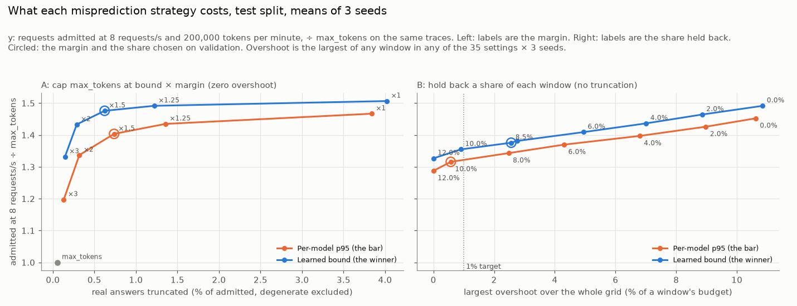

### 32. The buffer sized on validation does not hold on test: 2.56% overshoot where 1% was the target

On validation, the winner needs 8.5% of every window held back to keep the worst window in 105 runs at or under 1%. On test, that buffer gives 2.56% at 100k tokens per minute and 8 requests/s (and 1.16% at 12 requests/s); every 200k and 400k setting stays at 0. The bar's 10% happens to hold (0.57%). Two reasons, both structural rather than bad luck. First, **at a small budget one runaway is already past the target**: 1% of a 100k window is 1,000 tokens, and a completion that runs to 4,096 against a bound of a few hundred misses by about 3,500, so the buffer has to cover the coincidence of several runaways settling after their window closes, which is a far-tail event that 3 seeds per setting can only sample. Second, **overshoot does not fall smoothly as the buffer grows**: on validation the bar's worst window goes 3.1% at 5.5% held back, 4.8% at 6%, 2.3% at 6.5%, because each share changes which requests get in and so which runaways land in which window. A buffer tuned to a maximum on one set of traces is tuned to that set's few worst coincidences. B can make overshoot rare; it cannot promise a bound on it.

### 33. A cap at 1.5× the bound gives zero overshoot for 1% fewer admitted requests and 0.6% of answers cut short

At 8 requests/s the winner with A ×1.5 admits 19,745 requests, 1.0% fewer than unprotected (19,953) and 7.3% more than with B (18,404), and no window in any run overshoots, because no request can. The cost is truncation: **0.62% of admitted requests are real answers cut short** (0.76% counting degenerate runs), on top of the 0.06% that 4,096 already cuts (validation predicted 0.73%). Truncation does not depend on load: it is 0.55–0.82% of admitted requests at every one of the 35 settings, including 1 request/s, where the budget never binds and the cap buys nothing. A also raises wrongful 429s at 8 requests/s from 2,414 to 4,287, since reservations are 1.5× the bound while the real cost is unchanged, but B raises them to 10,547.

A ×1 is the extreme: it admits the most (1.507× `max_tokens`, more than unprotected, because the truncated requests cost less), at 4.0% of answers cut, i.e. every miss. The cut answers concentrate where Day 7's coverage was lowest: ShareGPT 2.1% and Apps 1.0% at ×1.5, against 0.2–0.3% for the code benchmarks and Dolly; by target model, Llama-3.2-1B (1.9%) and Llama-3.1-8B (1.5%) the most and Qwen2.5-14B the least (0.1%).

### 34. Under the same strategy the winner's edge over the bar doubles

Unprotected, the winner admits 2.7% more than the bar at 8 requests/s. With both under A ×1.5 it admits **5.2% more** (19,745 vs. 18,774), 7.2% at ×2 and 11.3% at ×3, because the margin multiplies the bound: a bound that is 22% smaller reserves 22% less at every margin, and the extra reserved tokens cost the bar more requests. Across the grid, winner + A ×1.5 against the bar + A ×1.5 is 1.00× wherever the budget does not bind and up to 1.20× (100k, 16 requests/s); it is never below 1. Against the *unprotected* bar it is 0.94–1.19×: the cap's 50% extra reservation is not free. B leaves the edge where it was (1.027–1.030× at every share), because a holdback shrinks every policy's window by the same amount.

With the cap, the ≥1.5× target over `max_tokens` is met from 6 requests/s at 100k (1.58×), from 12 requests/s at 200k (1.55×), and at 25 tokens/s from 4 requests/s (1.61–2.18×); still never at 100 tokens/s (at most 1.22×) or at 400k within 16 requests/s (1.46×). So finding 28 stands with the cap on.

### 35. Decision: strategy A at 1.5× the bound is the default; B stays an opt-in

**The gateway sends each request with `max_tokens` = min(ceil(1.5 × bound), the client's `max_tokens`) and reserves exactly that.** It is the only strategy that meets the PRD's overshoot target as stated (at most 1% of a window, the largest across runs): it has zero overshoot by construction, at any budget, load or decode speed, and on traffic unlike CASTILLO, where finding 24 expects coverage to drop. B, sized the same honest way, missed the target on test (2.56%) and costs 8% of the winner's admitted requests at 8 requests/s (up to 8% across the grid, never a gain). The margin costs 1% there; across the grid it ranges from 8% fewer admitted (6 requests/s at 25 tokens/s) to 8% more (16 requests/s at 100k), so neither strategy is free under slow decoding. What A gives up is 0.6% of real answers cut short (0.7% on validation), at every load. For a spend gateway that is the right side of the trade: a truncated response is visible to the client (`finish_reason = length`) and can be continued, while an overshoot is money spent past a hard cap that nobody approved. B remains an option, behind a flag, for deployments where no answer may be cut and the budget is soft, with the warning from finding 32 that its overshoot is a rate, not a bound. Two refinements belong to v2: apply the cap only when a window is close to full (finding 33: the cap truncates even when the budget is not binding), and replace the hard cap with the streaming top-up reservations already planned for January, so a long answer can ask for more budget instead of being cut. Finding 31's preference for cheap requests is unchanged by A (Apps 60.8% to Mbpp 74.0% admitted at 8 requests/s) and still needs to be stated in the README.

## Day 11: Export to ONNX (4 Nov 2026)

**Scope.** The frozen winner (the average of the MLP and XGBoost log predictions, shift +0.034) and its MiniLM-128 encoder exported to ONNX (`src/llm_reserve/export.py`), plus a serving runtime that goes from a request to a bound on ONNX Runtime alone (`src/llm_reserve/serving.py`). A request is the prompt text, the target model and `input_size`. The bundle in `data/models/onnx/` holds the encoder graph (BERT, then mean pooling over the mask, then L2 normalization, as sentence-transformers does it), the pinned fast tokenizer truncating at 128 word pieces, the MLP graph (standardization included), the XGBoost graph, the frozen PCA and `serving.json` (column order, model vocabulary, shift, a SHA-256 per file). The parity set is 1,000 test prompts drawn with seed 0 (every model each was answered by: 12,446 requests, 124,285 sanitized completions). Test is not re-scored here: the comparison is against the Day-7 predictions. Rebuild with `make onnx` (about 40 seconds); the numbers come from [`figures/onnx_parity.json`](figures/onnx_parity.json).

| Stage, ONNX vs its Python model on identical inputs | Largest difference (log1p tokens) |
|---|---|
| Tokenizer: `tokenizers` vs the sentence-transformers tokenizer | identical ids on all 1,000 prompts (457 truncated at 128) |
| Encoder vs sentence-transformers, one prompt at a time | 2.5e-7 per component (cached Day-4 embedding: 2.5e-7) |
| MLP vs torch: Day-7 inputs / serving inputs | 9.5e-7 / 9.5e-7 |
| XGBoost vs xgboost: Day-7 inputs / serving inputs | 1.3e-5 / 1.3e-5 |
| **Raw text → winner, ONNX vs the Python models fed the same embeddings** | **6.7e-6** (MLP 9.5e-7, XGBoost 1.3e-5) |
| Not gated: raw text → winner vs the Day-7 test predictions | 2.5e-3 on 27 requests (3 prompts); every other request ≤ 1e-4 |

**The gate passes:** every stage agrees within the PRD's 1e-4, end to end too. 12 of the 12,446 whole-token bounds differ from the Python ones, each by one token, where a 1e-5 difference crosses a `ceil`.

### 36. The export is exact; XGBoost's split thresholds turn 1e-7 of rounding into 0.5% of a bound

The first end-to-end run failed the gate as first written (served bounds vs the Day-7 predictions, 1e-4): 28 XGBoost predictions in 4 prompts were off by up to 5.0e-3. On the same inputs the exported trees match xgboost to 1.3e-5, so the export is not the cause. The inputs differ. Day 7 used the Day-4 embeddings, encoded in padded batches of 64 and projected onto the PCA in one large float32 matrix product. The service encodes one prompt at a time and projects one row. Both steps change the last bits of the 32 PCs (by up to about 5e-7), and a tree compares each PC to a float32 threshold, so a PC sitting within 1e-7 of a split flips the branch and moves the prediction by a whole leaf. It is not specific to ONNX. xgboost fed per-request PyTorch embeddings moves 28 of 12,446 predictions past 1e-4 (the ONNX encoder's moves 27), and uniform noise of ±3e-7 on the PCs moves 36–44 (up to 1.8e-2). The MLP is continuous and never moves by more than 2.4e-6.

Two changes followed, both made after that first run. **The PCA is now accumulated in float64** and cast to float32. In float32 the projection depended on the batch shape, so even the service and its own Python reference disagreed (2.0e-3 on the same embeddings). In float64 one request and a batch of 1,000 give identical PCs (a test asserts it). **The gate now compares each ONNX stage with its Python model on identical inputs**, which is what "ONNX and Python predictions agree" tests. The drift from Day 7 is reported instead. It is small: 21 of 12,446 bounds differ, by one token, and on the parity set coverage is identical (95.89%) and the reservation ratio moves from 1.8187783 to 1.8187793. So the Day-7 test numbers stand for the served model.

### 37. ONNX bought no latency, but the service needs neither torch nor xgboost

On one thread, after a 20-request warm-up, one request (one prompt, one model) takes **6.5 ms p50 and 10.8–12.5 ms p99** across four runs of the same 1,000 requests. The encoder is most of it: 6.3 ms p50 and 8.7 ms p99. The hand-built features and both regressors take 0.24 ms p50 and 2.6 ms p99. That is no faster than PyTorch: the PRD's day-0 check measured 5.6 ms p50 and 7.9 ms p99 for the 128-token encoder alone, though on 400 different prompts. The PRD warned not to count on ONNX for headroom, and it gives none. So the 15 ms `/predict` p99 target has about 2.5–4 ms left for HTTP, JSON and the event loop, which Day 13 measures. If it runs over, dynamic int8 quantization of the encoder is the next lever, but it would change the predictions and so needs its own coverage check on validation.

What the export does buy is a light image. The parity stage runs with neither torch, xgboost, transformers nor sentence-transformers imported, and it asserts this. So the Day-12 container needs only onnxruntime, tokenizers, numpy and pandas, plus a 94.5 MB bundle (the encoder is 91 MB). torch alone would be several hundred MB on CPU. It also removes findings 20's problem, two OpenMP runtimes in one process, from serving.

### 38. Three traps in the export, each of which would have served a different model

- **The saved booster has 960 rounds; the model was chosen at 860.** `predict_xgb` stops at `best_iteration`, but a converter exports every tree. The export slices the booster first and records both numbers.
- **onnxmltools only reads feature names of the form f0, f1, …** and supports opset 15 at most; the slice is exported without names, and `serving.json` carries the column order instead. The converter does carry XGBoost 3's quantile base score (6.91) correctly.
- **torch's dynamo exporter makes an invalid graph if the output is named `embedding`**, because the name is already used inside BERT ("duplicate definition"); the output is `sentence_vector`. The older TorchScript exporter worked too (2.3e-7) but is deprecated.

## Day 12: The service (5 Nov 2026)

**Scope.** A FastAPI service (`src/llm_reserve/service.py`) over the Day-11 `serving.Predictor` and Redis, in `docker-compose.yml` with Redis 7.4 (`make serve`, then `make demo` for the curl flow). No model, threshold or simulator number changes today; the bound the container serves for the demo prompt (211 tokens) is the one the local Predictor gives. Budget settings are the simulator's: 200,000 tokens per 60-second window, strategy A at ×1.5.

| Call | Input | Returns |
|---|---|---|
| `POST /predict` | prompt, model (Hugging Face or CASTILLO id), `input_tokens`, optional `max_tokens` | the 95% bound, the capped `max_tokens` to send, the tokens `/reserve` will hold, each member's log prediction |
| `POST /reserve` | `input_tokens`, `max_tokens`, optional `bound` | a reservation id and the `max_tokens` to send, or 429 with `Retry-After` (seconds to the next window) |
| `POST /settle` | reservation id, `input_tokens`, `output_tokens` | reserved, actual, the delta applied and the window's spend; 404 if unknown or already settled |
| `GET /budget`, `GET /healthz` | | the current window's spend; Redis and model status |

The demo (`scripts/demo.sh`) after `docker compose up`: Llama-3.1-8B, a 20-token prompt, bound 211, sent with `max_tokens` 317 (211 × 1.5), 337 tokens held; settling a 126-token answer charges 146 and frees 191. 19 new tests (127 in all) cover the two scripts on fakeredis (exact fill, one token over, reused id, double settle, settle after the window expired, 300 concurrent reserves), the cap against `mispredict.capped` and the Day-10 margin in `mispredict.json`, the API with a stub predictor (429 and `Retry-After`, billing across a window edge, bad ids and models), and `/predict` against the real ONNX bundle.

### 39. `/reserve` stays out of the model's way, and applies the Day-10 cap itself

`/predict` spends 8.7 ms of its 15 ms p99 budget in the encoder alone (findings 37), and `/reserve` has a 5 ms target, so reserving cannot include a prediction. The gateway makes two calls and passes the bound along; `/reserve` turns it into the cap (`min(ceil(bound × 1.5), max_tokens)`, the same rule as `mispredict.capped`, which a test checks) and returns the `max_tokens` the call must be sent with. A gateway that sends it cannot overshoot its window. One that ignores it falls back to the unprotected Day-9 behaviour, and `/settle` reports any overshoot. `/predict` is a plain function, so FastAPI runs it in its thread pool and inference never blocks the event loop that serves `/reserve`. The trust boundary is the gateway: a caller of `/reserve` can claim any bound, so the service belongs behind it, not on the internet.

### 40. Settle is a script too, so a retried settle cannot refund twice

The PRD asked for a Lua reserve and an `INCRBY` settle. A bare `INCRBY` would apply a retried settle twice and free tokens that were never reserved, so settle also runs as a script: it reads the reservation, applies `INCRBY` (actual − reserved) to its window and deletes it in one atomic step; a second settle gets a 404. Reserve checks and increments in one step, so there is no check-then-act race: 300 parallel reserves of 2,000 tokens against the compose Redis admitted 99, leaving 198,146 of 200,000 spent (146 were the demo's), the 100th refused. The window index is part of the reservation id, so settle bills the admitting window without a lookup, as the simulator does (Day 8); a settle after that window's key has expired (two windows) adjusts nothing. Two choices for later: the window comes from the API's clock, so several API replicas need synchronized clocks; and an unsettled reservation stays charged to its window, and is forgotten after an hour.

### 41. A 761 MB image without the training stack

The image installs only `requirements-serve.in` (FastAPI, uvicorn, redis, onnxruntime, tokenizers, numpy, pandas) with `requirements.txt` as a constraints file, so every version is the one pinned for training and nothing is pinned twice. torch, xgboost and scikit-learn are absent (checked in the container). Moving `data.py`'s `huggingface_hub` import into the download function keeps the service's imports light, though `tokenizers` installs `huggingface_hub` anyway. 761 MB is mostly onnxruntime, numpy and pandas on `python:3.12-slim` plus the 94.5 MB bundle; pandas is only there because `features.py` imports it at the top. A rebuild after a code change takes about 30 seconds.
