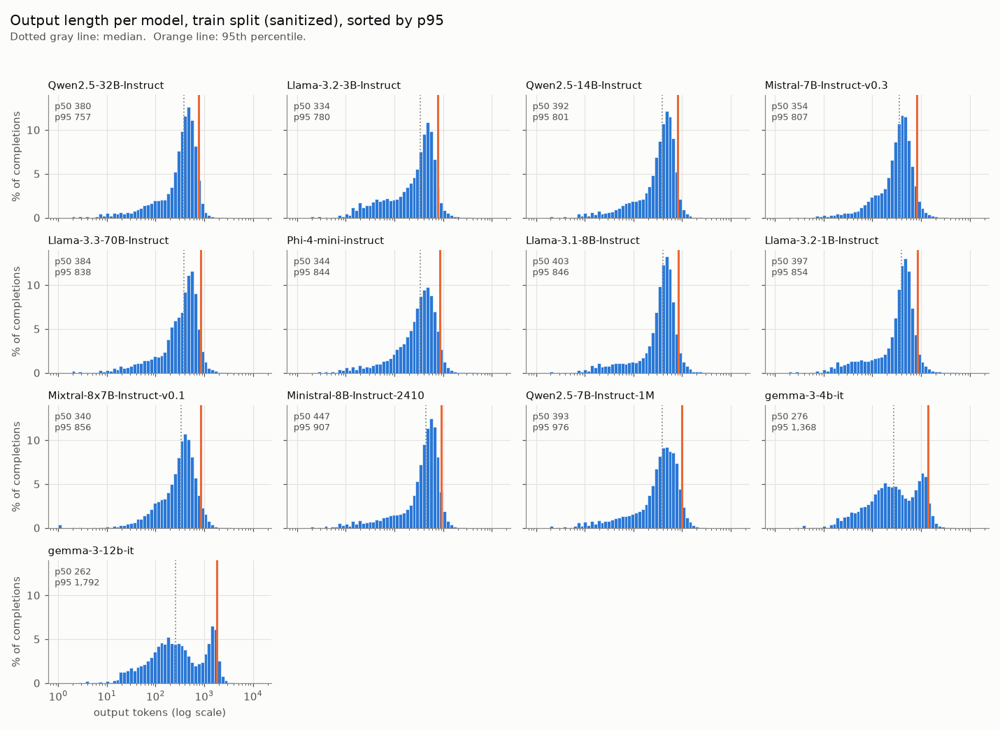
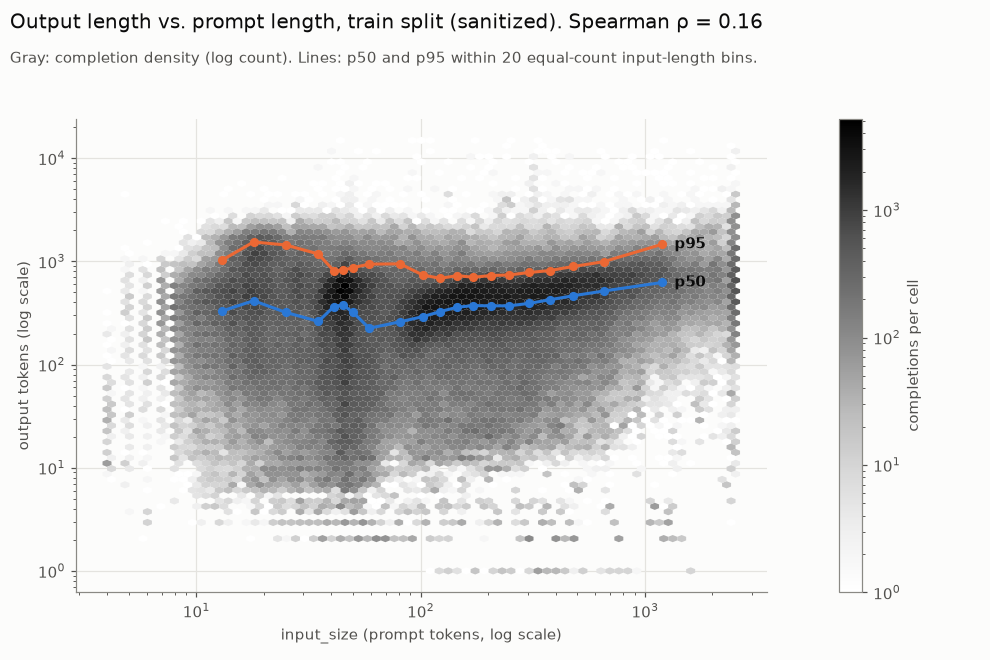
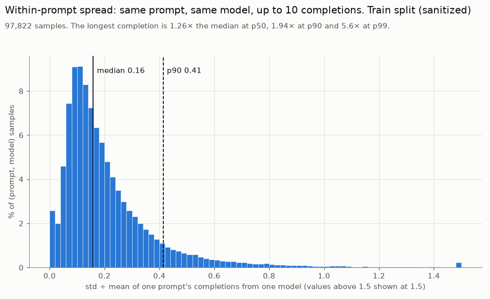
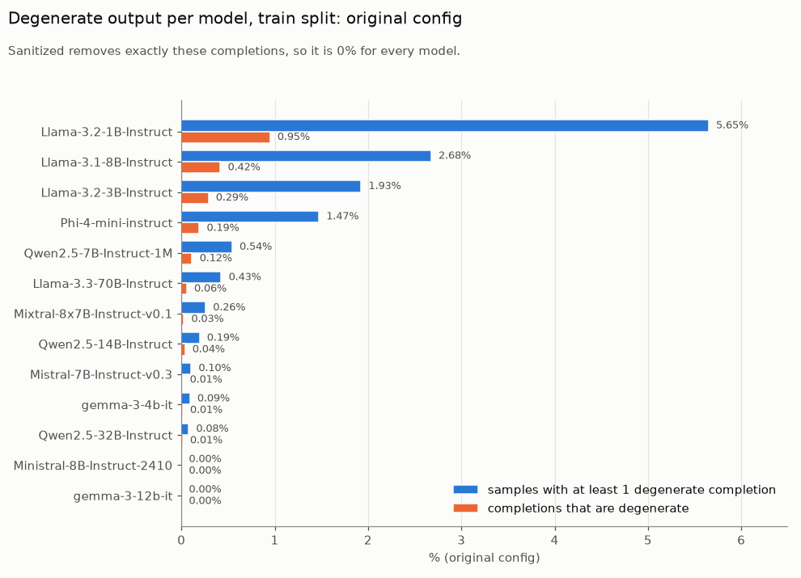
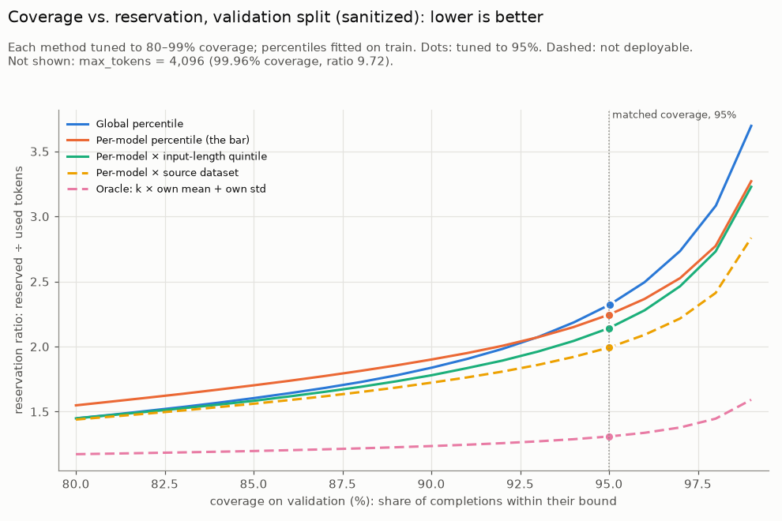
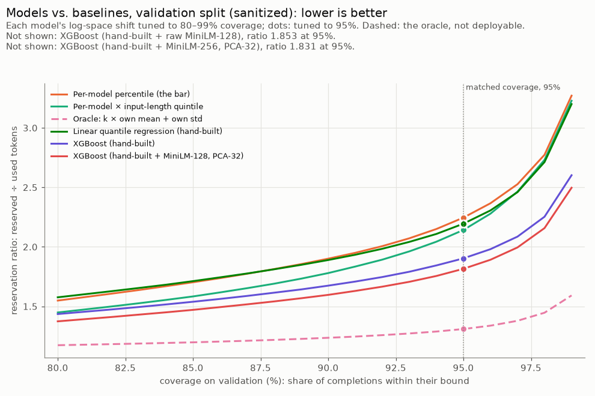
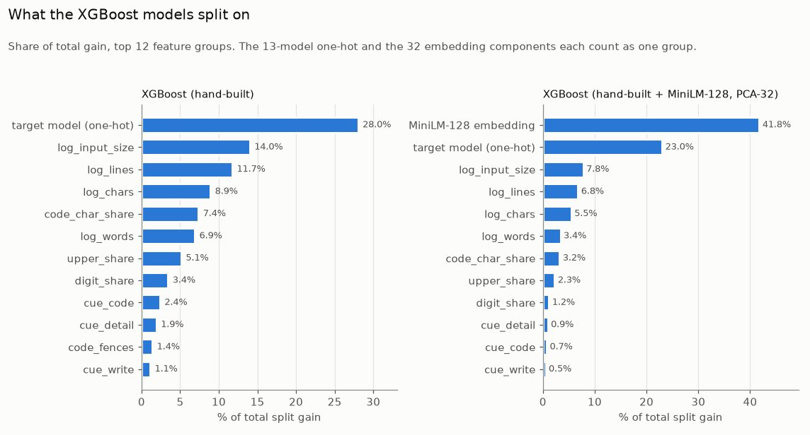

# Findings

Living results log for llm-reserve. Each section says which split it uses. The test split is not explored; it is scored once, on Day 7.

## Day 2: Exploring the data (30 Oct 2026)

**Scope.** Train split only: 7,999 prompts, 97,827 (prompt, model) samples, 976,769 sanitized completions (978,270 original). Validate is kept for tuning, so it isn't explored here. Rebuild everything below with `make explore`; the numbers come from [`figures/explore_stats.json`](figures/explore_stats.json).

Overall output length (sanitized): p50 369, p90 776, **p95 1,005**, p99 1,649, p99.9 2,652 tokens.

### 1. The prompt decides length, not the model

How much of the variance in log(1 + output tokens) each grouping explains, if you knew its exact mean length (in-sample, so an upper bound):

| Grouping | Known at serving time? | Log-variance explained |
|---|---|---|
| Model | yes | **0.6%** |
| Source dataset | no | 13.0% |
| Model × source dataset | no | 23.7% |
| Prompt | via its text | **70.6%** |
| Prompt × model | via its text and the model | **93.4%** |

The fixed per-model p95 (the Day-3 bar) uses only the first row. Knowing the source dataset, which we can't at serving time, still leaves most of the signal unused. The signal is in what each prompt asks for, which matches the data check: per-model × dataset only saves 11%, and the oracle saves about 40%.

**So:** the prompt-text features (Day 4) are the whole project. A model that mostly learns "which LLM" or "which kind of task" will lose to the per-model p95 by very little or tie it.

### 2. Models disagree about which prompts are long

Per-model p95 runs from 757 (Qwen2.5-32B) to 1,792 (gemma-3-12b). Eleven of the 13 models look alike: one main peak just below the p95, and a p95 between 757 and 977. The two gemma models are different: the **lowest medians (262 and 276) but the highest p95s (1,792 and 1,368)**, with a second peak around 1,500 tokens.

That second peak comes from the prompt type. gemma-3-12b is terse on code and verbose on chat; Qwen2.5-32B does the opposite:

| Source dataset | gemma-3-12b median | gemma-3-12b share > 1,000 | Qwen2.5-32B median | Qwen2.5-32B share > 1,000 |
|---|---|---|---|---|
| DS1000 (code) | 46 | 0% | 317 | 0% |
| Apps (code) | 196 | 1% | 576 | 1% |
| Alpaca (instructions) | 478 | 36% | 201 | 0% |
| ShareGPT (chat) | 1,369 | 67% | 455 | 4% |

Across all 13 models, the median correlation of per-prompt mean log length between two models is 0.81, so most prompts rank similarly. But going from "prompt" to "prompt × model" in the table above adds about 23 points of explained variance.

**So:** the model must interact with the prompt features, not just shift or scale them. XGBoost gets this from splits on the model one-hot. For the MLP (Day 6), feed the model embedding into the hidden layers, not only as an output offset. Gemma will dominate the per-model p95 cost, so it is also where a prompt-aware model can save the most.

### 3. Prompt length is a weak signal, and not a monotone one

Spearman ρ between `input_size` and output length is only **0.16**. The p95 per input-length bin is U-shaped:

| Prompt tokens (bin median) | 13–35 | 41–81 | 102–305 | 377–654 | 1,193 |
|---|---|---|---|---|---|
| Output p95 | 1,026–1,543 | 813–947 | 685–781 | 816–993 | 1,466 |

Very short prompts are mostly open-ended chat and instructions (ShareGPT median input 56 tokens, output p95 1,541). Mid-length prompts are mostly self-contained code tasks (Mbpp, DS1000: output p95 593–623). The longest prompts get longer answers again (Apps, the code dataset with the longest prompts at a median of 449 input tokens, has an output median of 486).

**So:** this is why the per-model × input-length quintile baseline only saves 4.6%. Use log `input_size` and let trees split it; a linear term in raw length will fit badly. Short prompts need the text features most, because their length tells you least.

### 4. The same prompt to the same model varies a lot, and by how much varies too

For each (prompt, model) pair, std ÷ mean across its completions: median **0.16**, p90 0.41, p99 0.98 (97,822 samples with at least 2 completions). The longest completion is 1.26× the median at p50, 1.94× at p90 and 5.6× at p99. About 7% of the log variance sits inside a (prompt, model) pair, and no prompt-only predictor can remove it. It is why even the oracle reserves 1.31× actual usage.

The spread itself varies a lot between prompts: a tenth of samples have a CV under 0.06 and a tenth have one above 0.41.

**So:** the 95% bound can't be "predicted mean × a constant". It needs the spread too, which is why the models are quantile models (pinball loss) and not mean regressors with a fixed multiplier. On Day 7, check whether under-predictions are concentrated in high-spread prompts.

### 5. Degenerate runs are a small-model problem; gemma's long outputs are real

In the original config, **5.65% of Llama-3.2-1B samples have at least one degenerate completion** (0.95% of its completions), then Llama-3.1-8B (2.68%), Llama-3.2-3B (1.93%) and Phi-4-mini (1.47%). The other nine models are at 0.54% or less. gemma-3-12b and Ministral-8B have none.

So gemma's heavy tail (finding 2) is not a decoding failure that sanitized hides: it is real, verbose output, and it is in the training data the model learns from.

Original vs. sanitized on train: 0.181% vs. 0.028% of completions are over 4,096 tokens, and 1,482 original completions hit the 15,000 cap. Only 2 samples are degenerate in all 10 completions (both Qwen, all at 15,001 tokens).

**So:** the simulator draws actual lengths from `original` (as planned), and its clipped-request and overshoot counts should be broken down per model, since four small models produce most of the runaway generations. A model trained on sanitized data will not predict these; that's expected and it's what the misprediction strategies on Day 10 are for.

## Day 3: Baselines locked (30 Oct 2026)

**Scope.** Validation split, sanitized config: 2,266 prompts, 277,351 completions, mean length 421. Every percentile and the input-length quintile edges are fitted on train; only the knob θ (which percentile, or the oracle's k) is tuned on validation, to the smallest value that reaches 95% coverage. Bounds are rounded up to whole tokens. Rebuild with `make baselines`; the numbers come from [`figures/baselines_validate.json`](figures/baselines_validate.json).

| Method | Deployable | Knob θ | Coverage (sanitized) | Coverage (original) | Reservation ratio | vs. the bar | Oracle gap closed |
|---|---|---|---|---|---|---|---|
| `max_tokens` = 4,096 | yes | — | 99.96% | 99.80% | 9.723 | +333.0% | — |
| Global percentile | yes | 0.9463 | 95.01% | 94.86% | 2.322 | +3.4% | −8.1% |
| **Per-model percentile (the bar)** | yes | 0.9539 | 95.00% | 94.85% | **2.246** | — | 0% |
| Per-model × input-length quintile | yes | 0.9529 | 95.00% | 94.85% | 2.142 | −4.6% | 11.1% |
| Per-model × source dataset | no | 0.9535 | 95.00% | 94.85% | 1.993 | −11.3% | 27.0% |
| Oracle: k × own mean + own std | no | 1.1093 | 95.00% | 94.94% | **1.309** | −41.7% | 100% |

"Coverage (original)" applies the same frozen θ to the original config, degenerate completions included (the oracle recomputes its mean and std there).

**The bar is 2.246.** A model hits the 20% target at a reservation ratio of **1.797** or less at 95% coverage on test, which is closing 48% of the gap to the oracle. These numbers reproduce the PRD data check (2.25 / 2.14 / 2.00 / 1.31) on the overlap-fixed validation split, so the baselines are locked.

### 6. The bar is only the strongest simple baseline near 95%

Below about 93% coverage, **one global percentile reserves less than the per-model percentile** (at 90%: 1.84 vs. 1.90). A per-model percentile gives every model the same coverage, which forces it to cover gemma's long second peak (finding 2) at the same rate as everyone else. A global percentile lets gemma's coverage drop and spends the savings on the other eleven models. Above 93%, the per-model percentile wins because the global one has to cover gemma's tail with everyone's bound.

**So:** equal coverage per model is not the cheapest way to reach 95% overall. A learned model is free to cover some models less, and that has to be visible: on Day 7, report coverage per model (and per source dataset) next to the overall number, so a win is not bought by quietly under-covering gemma.

### 7. Input length adds little, the dataset adds more, and both are small next to the prompt

Per-model × input-length quintile saves 4.6%. Knowing the source dataset, which the gateway can't, saves 11.3%. The oracle saves 41.7%. The gap between the bar and the oracle widens as coverage rises: 0.38 at 80% coverage (1.55 vs. 1.17), 0.94 at 95% and 1.68 at 99% (3.27 vs. 1.59). The tail is where a prompt-aware bound pays most. The sanitized-tuned θ loses 0.15 points of coverage on the original config for every percentile baseline, which is the degenerate tail that the simulator (Day 8) will have to absorb.

## Day 4: Features (31 Oct 2026)

**Scope.** Features for all three splits; the checks below fit on train and score on validation. Rebuild with `make features` (1 min 50 s from scratch, 18 s when the embeddings are cached); the numbers come from [`figures/features_validate.json`](figures/features_validate.json).

Every feature is computed from what a gateway has before it sends a request: the prompt text, `input_size` and the target model.

- **29 hand-built features:** size and shape (log characters, words, lines and bullets; code fences; shares of code characters, digits, upper case and non-ASCII; question marks; URLs), log `input_size`, 4 length hints and 13 cue words.
- **A 13-model one-hot,** with its vocabulary fitted on train.
- **MiniLM embeddings** (`all-MiniLM-L6-v2`, pinned revision), 384 dimensions, one per unique prompt (11,395), on CPU as at serving time. They are built at 128 tokens (the serving default) and at 256.

The matrix has one row per completion of the original config (sanitized is the `is_degenerate` filter, as on Day 1) and stores `prompt_row` instead of the embedding, so 1.4M rows × 384 floats are never materialized. Leakage is checked three ways: `check_no_leaks` runs whenever the matrix is built or loaded; a unit test shuffles the label, flips the degenerate flag and adds every never-column, and the features don't change; and on the real matrix every feature is constant within each (prompt, model) sample, so nothing that varies by completion, as the label does, can reach a model.

### 8. Length hints are precise but rare

When a prompt asks for a word count above 30, the answer follows it. Train prompts asking for 31–60, 61–120, 121–250, 251–600 and more than 600 words get median outputs of 61, 125, 224, 698 and 1,028 tokens. Asking for a number of sentences is just as telling: those prompts have a median output of 66 tokens, against 398 without one.

But the hints rarely fire. On train, a word count appears in 1.3% of prompts, a sentence count in 0.5%, a paragraph count in 0.04% and an item count ("list 10", "five ideas") in 4.2%. Item counts barely track length (rank correlation 0.09), since "N points" is often a geometry input in Apps, not a request. Counts of 30 words or fewer are mostly not hints at all: they are problem text in code tasks ("Given two words and a letter", "contains at least one word").

**So:** hints help the few prompts that have them and can't carry the project. Most of the signal has to come from the embedding.

### 9. The embedding carries most of the signal, and 128 tokens costs nothing measurable

As a probe, not a model: a ridge regression of each (prompt, model) sample's mean log length, fitted on train, then scored as the share of completion-level log-length variance it explains on validation. λ is picked on validation from 1 to 10⁵.

| Features | Count | Validation R² of log length |
|---|---|---|
| Model one-hot | 13 | 0.5% |
| + hand-built | 42 | 14.9% |
| Model + MiniLM-128 | 397 | 33.5% |
| **+ hand-built + MiniLM-128** | 426 | **37.5%** |
| + hand-built + MiniLM-256 | 426 | 37.0% |
| Ceiling: each sample's own mean (in-sample) | — | 93.2% |

The embedding alone explains more than twice as much as the hand-built features, and together they add 4 points to the embedding alone. 256 tokens is no better than 128 in this probe (37.0% vs. 37.5%), even though 46% of prompts are cut at 128 MiniLM tokens and 28% at 256. Code tasks are 76% of the prompts cut at 128 (Apps alone 39%; 98% of Apps prompts are cut), ShareGPT and Dolly's pasted context most of the rest, and the log character and line counts still see the full length.

A linear probe can't model the prompt × model interaction (finding 2), which is most of the gap to the ceiling, so Day 5's XGBoost should land well above 37.5%. The 128 vs. 256 check reruns there, on the reservation ratio, before 128 is frozen.

### 10. The text names its source dataset, so the 11% reference row is not out of reach

The dataset is never a feature. But a nearest-centroid rule on the embedding alone names a validation prompt's source dataset 77% of the time at 128 tokens (80% at 256), across 7 datasets, because CASTILLO's datasets have fixed templates ("QUESTION:", "You are an expert Python programmer", "Problem:", "Context:"). Per-model × source dataset, a reference row that is "not deployable" on Day 3 (ratio 1.993, −11.3%), is therefore largely reachable from the text on this data.

That is fair at serving time, since the template is in the prompt. But real gateway traffic has no CASTILLO templates, so part of any gain may not transfer. **So:** the Day-7 leave-one-dataset-out check is no longer a stretch goal. It is the test of whether the model learned what prompts ask for or which benchmark they came from.

## Day 5: Linear and XGBoost models (31 Oct 2026)

**Scope.** Trained on train (sanitized, 976,769 completions), tuned on validation (sanitized, 277,351 completions); test is not loaded. Each model predicts the 95th percentile of log1p(output tokens) with the pinball loss. Its knob θ is an additive shift on that log prediction, bound = ⌈expm1(prediction + θ)⌉, tuned on validation to the smallest shift that reaches 95% coverage, the same protocol as the baselines. XGBoost early-stops on validation pinball loss. Rebuild with `make models` (7 min: 2 min for the linear LP, 3 min for the raw-embedding XGBoost, about 30 s for each other model); the numbers come from [`figures/models_validate.json`](figures/models_validate.json). The fitted models and their frozen shifts are in `data/models/` for Day 7.

| Method | Shift θ | Coverage (sanitized) | Coverage (original) | Reservation ratio | vs. the bar | Oracle gap closed |
|---|---|---|---|---|---|---|
| Per-model percentile (the bar) | — | 95.00% | 94.85% | 2.246 | — | 0% |
| Per-model × input-length quintile | — | 95.00% | 94.85% | 2.142 | −4.6% | 11.1% |
| Linear quantile regression (hand-built) | +0.017 | 95.00% | 94.85% | 2.195 | −2.3% | 5.4% |
| XGBoost (hand-built) | +0.043 | 95.00% | 94.85% | 1.903 | −15.3% | 36.6% |
| XGBoost (hand-built + raw MiniLM-128, 384 dims) | +0.094 | 95.00% | 94.85% | 1.853 | −17.5% | 41.9% |
| **XGBoost (hand-built + MiniLM-128, PCA-32)** | +0.082 | 95.00% | 94.85% | **1.815** | **−19.2%** | **45.9%** |
| XGBoost (hand-built + MiniLM-256, PCA-32) | +0.084 | 95.00% | 94.85% | 1.831 | −18.4% | 44.2% |
| Oracle: k × own mean + own std | — | 95.00% | 94.94% | 1.309 | −41.7% | 100% |

"Hand-built" always includes log `input_size` and the 13-model one-hot. The linear model is fitted on a random 50,000 completions (the exact LP takes 2 minutes at that size, and 5 seconds at 10,000).

### 11. XGBoost beats the bar by 19% on validation, just short of the 20% target

The best model, XGBoost on hand-built features plus a 32-component PCA of the MiniLM-128 embedding, reserves 1.815× what is used at 95% coverage, against 2.246 for the per-model percentile. That closes 46% of the gap to the oracle, short of the 48% (1.797) the target asks for **on test**. The lead holds along the whole curve: 1.37 vs. 1.55 at 80% coverage, 1.60 vs. 1.90 at 90%, and 2.50 vs. 3.27 at 99%. The frozen shift loses the same 0.15 points of coverage on the original config as every baseline.

Two things make this validation number optimistic. Both early stopping and the shift are tuned on validation, and the feature design below was chosen on validation from 12 configurations. Day 7's test score is the number that counts. **So:** XGBoost beats the fixed 95th percentile, and the 20% target is not reached yet. Day 6's MLP, with the model interacting with the prompt in its hidden layers, has to find the last 1–2%.

### 12. Trees overfit the raw embedding; a 32-component projection fixes it

Each train prompt appears in about 120 rows (10 completions × 12 models) with the same 384 embedding values, so a tree can carve out a single prompt and fit its completions. On the raw embedding, validation pinball loss gets **worse** than with hand-built features alone (0.0599 vs. 0.0595), and early stopping triggers sooner (473 vs. 732 rounds). The reservation ratio still improves a little, because the bound's ranking gets better while its calibration gets worse. Every configuration tried, on validation:

| Embedding features | `min_child_weight` | Validation pinball loss | Ratio at 95% |
|---|---|---|---|
| none | 20 | 0.05951 | 1.907 |
| none | 300 | 0.05898 | 1.903 |
| raw MiniLM-128 (384) | 20 | 0.05988 | 1.874 |
| raw MiniLM-128 (384) | 300 | 0.05948 | 1.853 |
| raw MiniLM-256 (384) | 20 | 0.05961 | 1.861 |
| PCA-16 of MiniLM-128 | 300 | 0.05677 | 1.827 |
| PCA-32 of MiniLM-128 | 20 | 0.05723 | 1.828 |
| **PCA-32 of MiniLM-128** | **300** | **0.05688** | **1.815** |
| PCA-64 of MiniLM-128 | 300 | 0.05727 | 1.815 |
| PCA-32 of MiniLM-256 | 300 | 0.05759 | 1.831 |
| Out-of-fold ridge score of the embedding (1 feature) | 20 | 0.05724 | 1.831 |
| Ridge score + PCA-32 | 20 | 0.05698 | 1.819 |

The PCA is fitted on train prompts only. Projecting to 16–64 components gives the trees a few dense directions instead of 384 noisy ones. A `min_child_weight` of 300 (more than one prompt's ~120 rows) stops leaves from isolating a single prompt. The two fixes add up. PCA-64 ties PCA-32 on ratio but has a worse pinball loss and twice the inputs, so PCA-32 is frozen. A stacked ridge score of the embedding does as well as PCA, but needs out-of-fold fitting and gains nothing. Training also gets 6× faster (33 s vs. 3 min).

The shift θ tells the same story. The linear model needs +0.017 to reach 95%, so its training quantile was almost calibrated on new prompts. XGBoost on hand-built features needs +0.043, and the embedding models need +0.08 to +0.09: their raw 95th-percentile predictions run 8–9% low on prompts they have not seen.

### 13. 128 tokens wins again, so it is frozen

With the frozen design, MiniLM-128 beats MiniLM-256 (1.815 vs. 1.831, pinball 0.0569 vs. 0.0576). On the raw embedding, 256 was slightly ahead (1.861 vs. 1.874), but both of those models overfit. This matches the Day-4 probe (37.5% vs. 37.0%) and the latency check, so **128 tokens is frozen** for training and serving.

### 14. The linear model only beats the bar because of the prompt's length

Linear quantile regression saves 2.3% and loses to the per-model × input-quintile baseline (2.195 vs. 2.142). A linear model in log space can shift each model's bound by a constant, and scale it with input length and cue words, but it can't let a feature mean different things for different models (finding 2) or bend with input length (finding 3). XGBoost on the same features saves 15.3%, so the hand-built features carry the signal and linear quantile regression can't use it.

### 15. What the trees use, and who they under-cover

With the embedding, its 32 components take 42% of the total split gain, the model one-hot 23%, and the size features (log input size, lines, characters, words) 24%. Without it, the model one-hot leads (28%), followed by the size features (42% together) and the code-character share (7%). The cue words and length hints get under 2.5% each in both models: the hints fire on too few prompts (finding 8).

Coverage per model at the frozen shift ranges from **93.9% (gemma-3-4b)** to 95.8% (Mistral-7B). The hand-built XGBoost ranges from 94.5% to 96.4%. The embedding model buys part of its saving by under-covering gemma-3-4b, the model with the long second peak (finding 6). That is the risk flagged on Day 3. Day 7 reports it next to the headline number, and the simulator will show whether a 1-point coverage loss on one model matters for overshoot.
